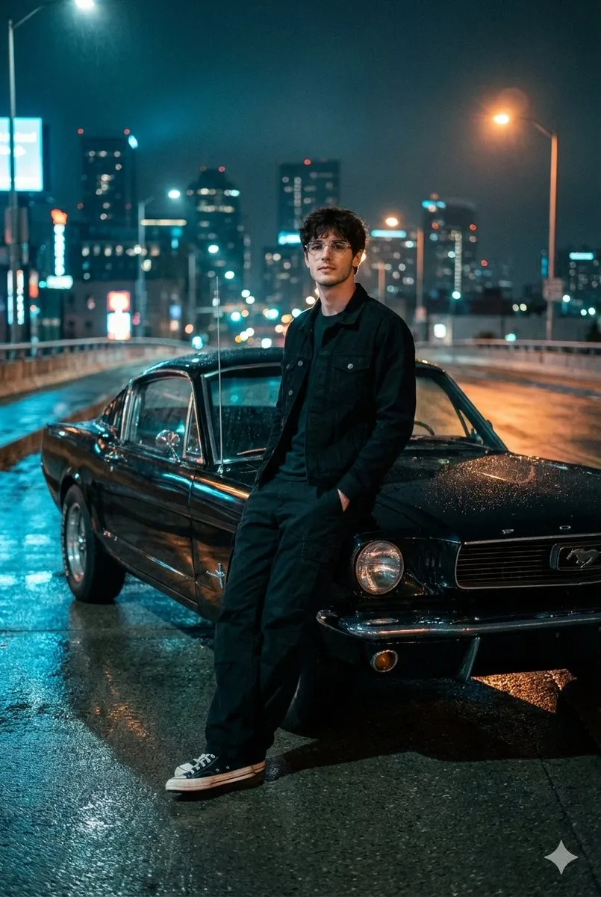

# Harboriis — by @harboriis

[← Back to Community Examples](../../EXAMPLES.md) · Category: Photography · Model: `Nano Banana`

<a href="https://x.com/harboriis/status/2024838490785984655"></a>

Source: **[@harboriis on X](https://x.com/harboriis/status/2024838490785984655)** · Creator: [Harboriis](https://x.com/harboriis)

## Prompt

```text
A Cinematic Night Photo On A Dimly Lit Urban Overpass With A View Of The City Skyline. In The Foreground, A Young Man Leaning Casually Against A Classic 1960s Ford Mustang Fast-back In A Sleek Black Finish. The Car's Muscu-lar Lines Are Accentuated By The Wet Asphalt Reflecting Neon Signs From Nearby Buildings. The Young Man Is Wearing A Black Trucker Jacket, A Simple Casual T-shirt, Loose Cargo Pants, And Converse Shoes. His Pose Is Re-laxed, One Hand In His Pocket, Looking Di-rectly At The Camera With A Cool, Confident Expression.

The Shooting Style Uses A Fujifilm Camera With Soft Cinematic Color Tones, A Slight Fine Grain, And Deep Shadows. The Dominant Color Tone Is A Moody Blue-teal, With High-lights From Warm Streetlights Creating A Dramatic Contrast. The Depth Of Field Is Shal-low, With Sharp Focus On The Young Man And The Mustang, While The City Lights In The Background Blur Into Soft, Cinematic Bokeн, Evoking The Aesthetic Of A Modern Analog Film Snapshot.
```

## Try it

Paste the prompt into **[vinano.ai](https://vinano.ai?utm_source=github&utm_medium=readme&utm_campaign=awesome-image-video-prompts-updating&utm_content=x-page-try)** to generate your own version.

> The image and prompt belong to @harboriis ([original post](https://x.com/harboriis/status/2024838490785984655)) and are shown here with credit for reference. Creators can ask for changes or removal by opening an issue.
