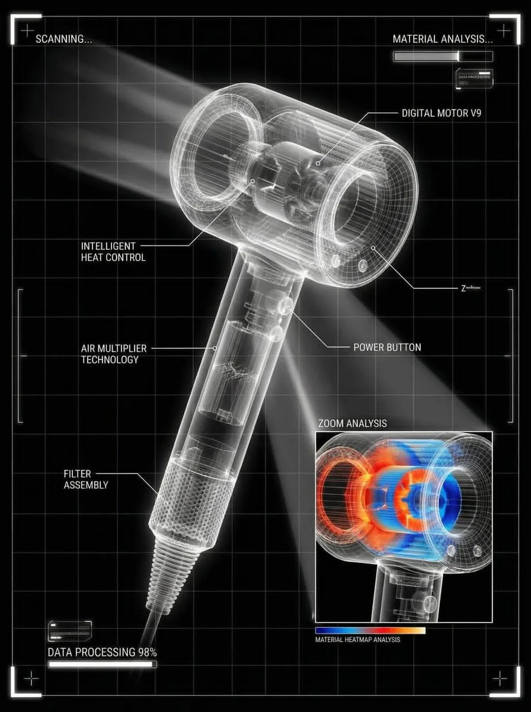

# Oogie — by @oggii_0

[← Back to Community Examples](../../EXAMPLES.md) · Category: Product & Brand · Model: `Nano Banana`

<a href="https://x.com/oggii_0/status/2040835609850474571"></a>

Source: **[@oggii_0 on X](https://x.com/oggii_0/status/2040835609850474571)** · Creator: [Oogie](https://x.com/oggii_0)

## Prompt

```text
You are a world-class director of industrial visualization and a futuristic interface designer specializing in advanced visual engineering diagnostic tools.

Your task is to transform the downloaded product into a futuristic visualization of the technical scanning interface, similar to the product analyzed in a high-tech laboratory diagnostic system.

input:
uploaded product image

style:

• black background with a clear white grid of the drawing
• the product is made in the form of a luminous translucent X-ray frame model
• clear geometry of the technical grid
• Ultra-sharp white lines and edges
• Minimalistic HUD interface design in sci-fi style

INTERFACE ELEMENTS:

• thin white lettering-callouts with pointer lines describing the components of the product
• Zoom analysis field, showing a product fragment in close-up
• A colored layer of the heat map of the material (red/ orange/blue) is displayed inside the zoom field.
• Scan indicators such as:
"THE SCAN..."
"MATERIAL ANALYSIS..."
"98% DATA PROCESSING"
• Small loading panels and user interface diagnostic modules
• luminous markers in the form of angular frames around the image

VISUAL LANGUAGE:

• Advanced engineering drawing design
• Futuristic laboratory scanning interface
• Engineering visualization of the product at the Apple level
• Ultra-pure composition
• High-contrast black and white interface

lighting:

• subtle white glow around the frame
• Volumetric light beam scanning
• Technical sci-fi visualization

composition:

• in the center of the product
• Grid-aligned interface layout
• Scalable analysis panel in one corner
• Minimalistic but highly technical

exit:

Futuristic product scanning interface
, visualization of technical diagnostics
, technical analysis screen
, ultra clean, ultra clear, 8K
```

## Try it

Paste the prompt into **[vinano.ai](https://vinano.ai?utm_source=github&utm_medium=readme&utm_campaign=awesome-image-video-prompts-updating&utm_content=x-page-try)** to generate your own version.

> The image and prompt belong to @oggii_0 ([original post](https://x.com/oggii_0/status/2040835609850474571)) and are shown here with credit for reference. Creators can ask for changes or removal by opening an issue.
