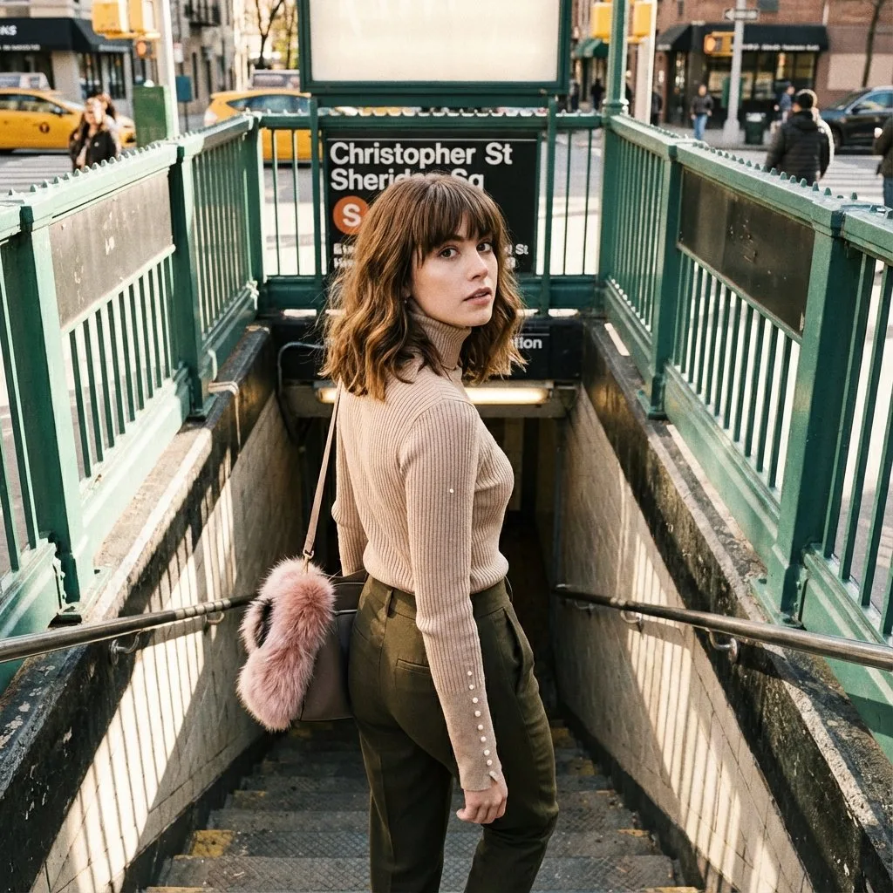

# 𝗦𝗮𝗻𝗶𝗮 — by @saniaspeaks_

[← Back to Examples from X](../../EXAMPLES.md) · Category: Photography · Model: `Nano Banana`

<a href="https://x.com/saniaspeaks_/status/2018178058868732010"></a>

Original post: **[@saniaspeaks_ on X](https://x.com/saniaspeaks_/status/2018178058868732010)** · Creator: [𝗦𝗮𝗻𝗶𝗮](https://x.com/saniaspeaks_)

## Prompt

```text
{
  "image_generation": {
    "subject": {
      "description": "young woman standing at the entrance of a subway staircase in a city",
      "pose": "standing on subway steps, body facing downward, head turned back over shoulder",
      "expression": "calm, slightly curious, thoughtful",
      "gaze": "looking directly at the camera"
    },
    "appearance": {
      "hair": {
        "color": "light brown",
        "style": "shoulder-length wavy hair with bangs"
      },
      "face": {
        "skin_tone": "fair",
        "makeup": "natural makeup with subtle definition"
      },
      "accessories": [
        "small shoulder bag",
        "pink faux-fur bag accessory"
      ]
    },
    "outfit": {
      "top": "beige fitted ribbed turtleneck sweater with button details on sleeves",
      "bottom": "high-waisted olive green tailored pants",
      "footwear": "not visible"
    },
    "environment": {
      "setting": "urban subway entrance",
      "background_elements": [
        "green metal railings",
        "subway sign reading Christopher St Sheridan Sq",
        "city street with pedestrians and taxis"
      ],
      "location_vibe": "busy city atmosphere"
    },
    "lighting": {
      "type": "natural daylight",
      "direction": "soft ambient street lighting",
      "quality": "balanced with gentle highlights and shadows"
    },
    "camera": {
      "angle": "slightly elevated eye-level",
      "framing": "three-quarter body shot",
      "lens": "35mm",
      "depth_of_field": "moderate, subject in sharp focus with softly blurred background"
    },
    "aesthetic": {
      "style": "urban lifestyle fashion photography",
      "vibe": "cinematic, casual, metropolitan",
      "color_palette": "warm neutrals, olive green, muted city tones"
    },
    "quality": {
      "realism": "highly realistic",
      "resolution": "high resolution",
      "look": "editorial street-style photograph"
    }
  }
}
```

## Try it

Paste the prompt into **[vinano.ai](https://vinano.ai?utm_source=github&utm_medium=readme&utm_campaign=awesome-image-video-prompts-updating&utm_content=x-page-try)** to generate your own version.

> The image and prompt belong to [@saniaspeaks_](https://x.com/saniaspeaks_) and are shown here with credit for reference. Creators can ask for changes or removal by opening an issue.
