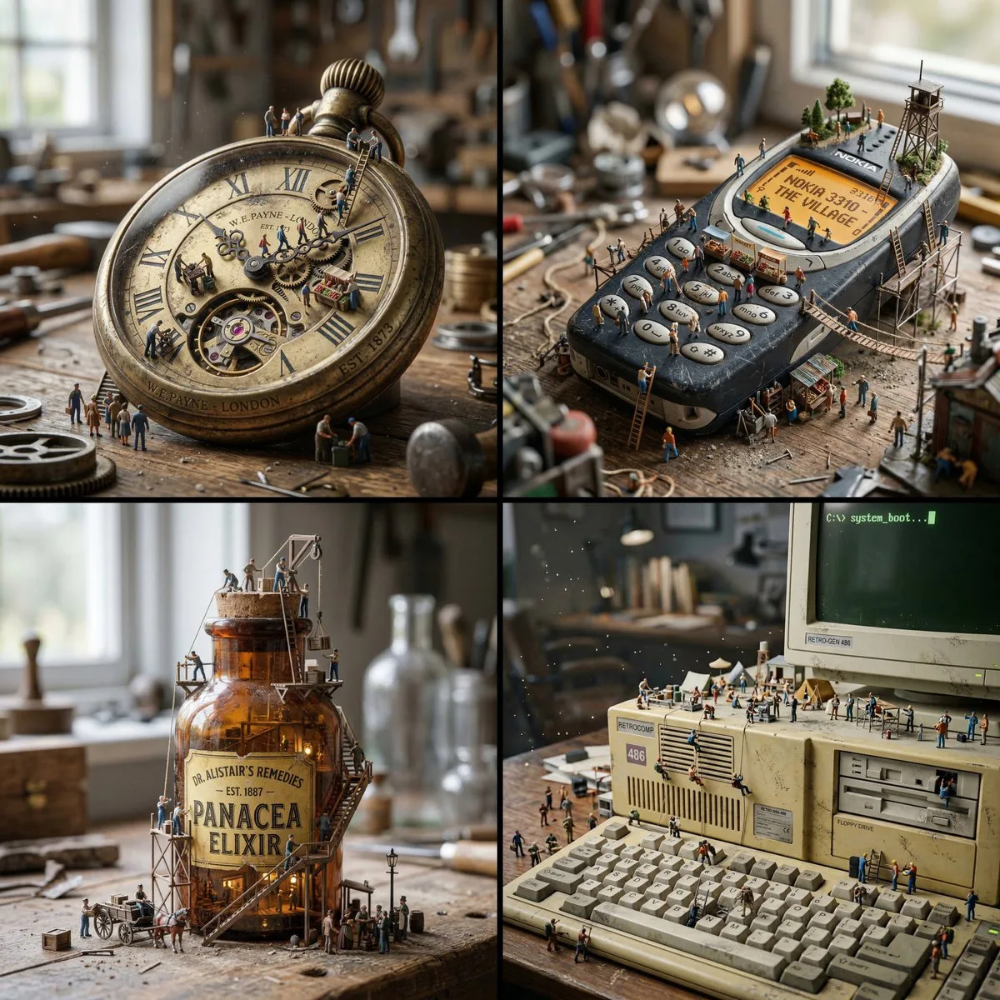

# DrSadek 🪶 — by @DrSadek_

[← Back to Community Examples](../../EXAMPLES.md) · Category: Photography · Model: `Nano Banana`

<a href="https://x.com/DrSadek_/status/2033136123342401904"></a>

Source: **[@DrSadek_ on X](https://x.com/DrSadek_/status/2033136123342401904)** · Creator: [DrSadek 🪶](https://x.com/DrSadek_)

## Prompt

```text
Create a hyper-realistic macro photograph of a miniature surreal scene. The environment is dominated by a giant, oversized <everyday object>, which has been repurposed as a bustling landscape. Tiny, highly detailed miniature human figures are interacting around and on the object. Shot on an 85mm macro lens with a shallow depth of field (f/1.8) to heavily blur the distant background. Lighting is soft, directional, and casts appropriate micro-shadows to emphasize the massive scale of the object relative to the figures. Intricate environmental details like dust particles and surface scratches are visible on the object. Cinematic, photorealistic, 4K.
```

## Try it

Paste the prompt into **[vinano.ai](https://vinano.ai?utm_source=github&utm_medium=readme&utm_campaign=awesome-image-video-prompts-updating&utm_content=x-page-try)** to generate your own version.

> The image and prompt belong to @DrSadek_ ([original post](https://x.com/DrSadek_/status/2033136123342401904)) and are shown here with credit for reference. Creators can ask for changes or removal by opening an issue.
