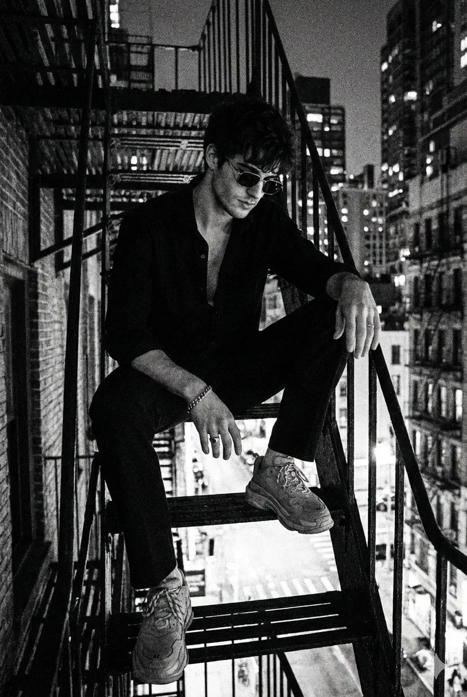

# Harboriis — by @harboriis

[← Back to Examples from X](../../EXAMPLES.md) · Category: Photography · Model: `Nano Banana`

<a href="https://x.com/harboriis/status/2022616495097024777"></a>

Original post: **[@harboriis on X](https://x.com/harboriis/status/2022616495097024777)** · Creator: [Harboriis](https://x.com/harboriis)

## Prompt

```text
Create a portrait without changing the facial features. A black and white artistic photograph of a man in a noir style. The man is sitting on a metal staircase or balcony with a cityscape in the background. He is wearing a dark shirt with an open collar, dark trousers, chunky sneakers, and sunglasses. Accessories are visible on his hands, including a bracelet. His pose is relaxed, with his gaze directed downward. The lighting is high contrast with deep shadows. The atmosphere reflects a 90s megacity, with strong film grain, street fashion aesthetics, and a grunge mood.
High contrast lighting, film grain, 90s street style aesthetic, gritty noir atmosphere, grainy texture, 35mm film look.
```

## Try it

Paste the prompt into **[vinano.ai](https://vinano.ai?utm_source=github&utm_medium=readme&utm_campaign=awesome-image-video-prompts-updating&utm_content=x-page-try)** to generate your own version.

> The image and prompt belong to [@harboriis](https://x.com/harboriis) and are shown here with credit for reference. Creators can ask for changes or removal by opening an issue.
