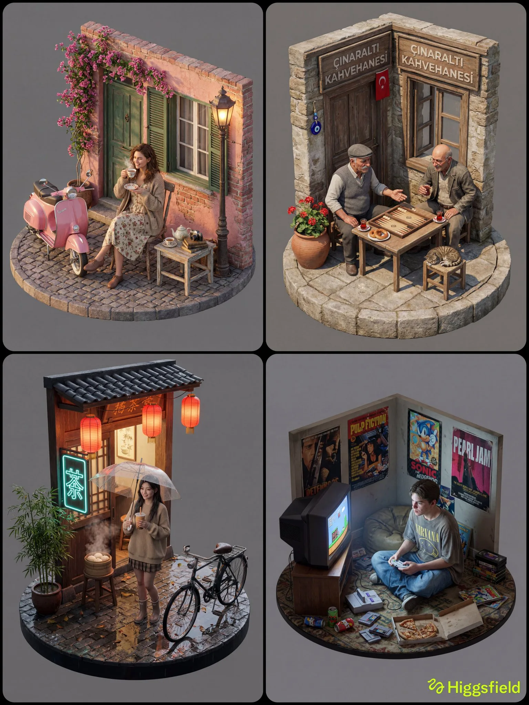

# ΛRMIN | AI — by @Arminn_Ai

[← Back to Examples from X](../../EXAMPLES.md) · Category: Illustration & 3D · Model: `Nano Banana`

<a href="https://x.com/Arminn_Ai/status/2008952931484098637"></a>

Original post: **[@Arminn_Ai on X](https://x.com/Arminn_Ai/status/2008952931484098637)** · Creator: [ΛRMIN | AI](https://x.com/Arminn_Ai)

## Prompt

```text
Concept: A hyper-realistic 3D isometric view of a [INSERT LOCATION] scene on a circular base.
Subject (Visuals): A full-body, realistic human [INSERT DESCRIPTION].
* Texture Rule: The subject must have "Living Human Skin" texture (subsurface scattering, pores, natural imperfections).
* Important: He is NOT a toy/doll. He looks like a real person inserted into the scene.
* Pose: [INSERT POSE, e.g., Sitting naturally].

Composition & Scale (Crucial):
* Camera: Isometric wide shot (Full view). ensure the entire circular base, the subject, and all props are visible within the frame.
* Proportions: PERFECT RELATIVE SCALE. The props (e.g., scooter, table etc.) must be the correct size relative to the human. Do not make the human giant or the props tiny.

Environment: A realistic section of a [INSERT WALL/BUILDING] behind the subject.
* Material: Real weathered textures (brick, cement, wood), not painted model textures.

Props:
* [INSERT PROP 1, e.g., Vintage Vespa] (Real metal and chrome texture).
* [INSERT PROP 2, e.g., Pizza and Wine] (Real food texture).
* *Note:* Ensure all props are present and grounded on the base.

Technical Specs: Unreal Engine 5 render style, 8k resolution, global illumination, raytracing, sharp focus on the entire scene (deep depth of field), solid neutral grey background.

Negative Prompt: Toy, plastic, doll, action figure, clay, resin, shallow depth of field (blur), close-up, cropped, distorted proportions, giant head, cartoonish, missing limbs, unfinished.
```

## Try it

Paste the prompt into **[vinano.ai](https://vinano.ai?utm_source=github&utm_medium=readme&utm_campaign=awesome-image-video-prompts-updating&utm_content=x-page-try)** to generate your own version.

> The image and prompt belong to [@Arminn_Ai](https://x.com/Arminn_Ai) and are shown here with credit for reference. Creators can ask for changes or removal by opening an issue.
