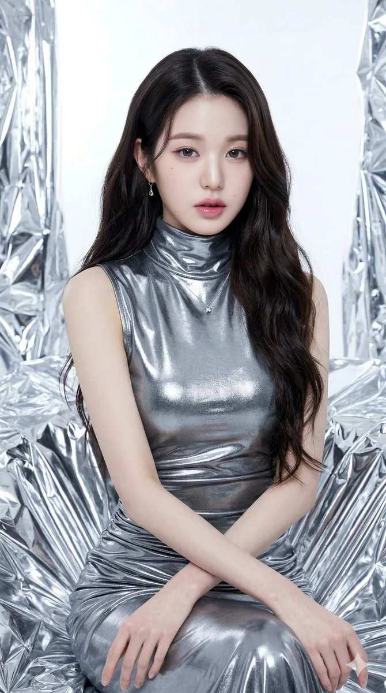

# Alice — by @youngcatwoman

[← Back to Examples from X](../../EXAMPLES.md) · Category: Photography · Model: `Nano Banana`

<a href="https://x.com/youngcatwoman/status/2037653892843114830"></a>

Original post: **[@youngcatwoman on X](https://x.com/youngcatwoman/status/2037653892843114830)** · Creator: [Alice](https://x.com/youngcatwoman)

## Prompt

```text
{
  "meta": {
    "image_quality": "High",
    "image_type": "Photo/Digital Render",
    "resolution_estimation": "1080x1920 (aspect ratio 9:16)"
  },
  "global_context": {
    "scene_description": "Jang Wonyoung of IVE poses in a highly reflective, futuristic environment constructed entirely of crumpled silver metallic foil. She has her signature long, wavy dark hair and doll-like features, including her distinct beauty marks. She is wearing a matching sleeveless, high-neck metallic silver dress. The scene is bathed in bright, diffused white light.",
    "time_of_day": "Indeterminate/Studio lighting",
    "weather_atmosphere": "Clinical/Futuristic/Monochromatic",
    "lighting": {
      "source": "Artificial",
      "direction": "Omnidirectional/Diffused",
      "quality": "Soft but creating high-contrast reflections",
      "color_temp": "Neutral/Cool"
    }
  },
  "color_palette": {
    "dominant_hex_estimates": ["#C0C0C0", "#E5E5E5", "#1A1A1A"],
    "accent_colors": ["Silver", "Chrome", "Dewy Skin Tone"],
    "contrast_level": "High"
  },
  "composition": {
    "camera_angle": "Eye-level",
    "framing": "Medium-shot/Vertical",
    "depth_of_field": "Medium",
    "focal_point": "Jang Wonyoung's face and eyes"
  },
  "objects": [
    {
      "id": "obj_001",
      "label": "Jang Wonyoung",
      "category": "Person",
      "location": "Center foreground",
      "prominence": "Foreground",
      "visual_attributes": {
        "color": "Fair skin, dark espresso hair",
        "texture": "Dewy glass skin, silky hair, metallic clothing",
        "material": "Skin/Hair/Fabric",
        "state": "Posed",
        "dimensions_relative": "Dominates vertical center"
      },
      "micro_details": [
        "Signature symmetrical beauty marks",
        "Plump gradient pink lips",
        "Small silver drop earring on left ear",
        "Thin silver necklace with a small pendant",
        "Soft shadows under the jawline",
        "Fingers of right hand resting on left forearm"
      ],
      "pose_or_orientation": "Seated/Kneeling, facing forward, arms crossed loosely at waist",
      "text_content": null
    },
    {
      "id": "obj_002",
      "label": "Metallic Dress",
      "category": "Clothing",
      "location": "Center",
      "prominence": "Foreground",
      "visual_attributes": {
        "color": "Polished Silver/Chrome",
        "texture": "Liquid-like, reflective",
        "material": "Synthetic Metallic Fabric",
        "state": "New/Tight-fitting"
      },
      "micro_details": [
        "Horizontal tension folds across the waist",
        "High turtleneck collar reflecting the chin",
        "Distorted reflection of foil room",
        "Sleeveless cut-outs"
      ],
      "pose_or_orientation": "Form-fitting",
      "text_content": null
    }
  ]
}
```

## Try it

Paste the prompt into **[vinano.ai](https://vinano.ai?utm_source=github&utm_medium=readme&utm_campaign=awesome-image-video-prompts-updating&utm_content=x-page-try)** to generate your own version.

> The image and prompt belong to [@youngcatwoman](https://x.com/youngcatwoman) and are shown here with credit for reference. Creators can ask for changes or removal by opening an issue.
