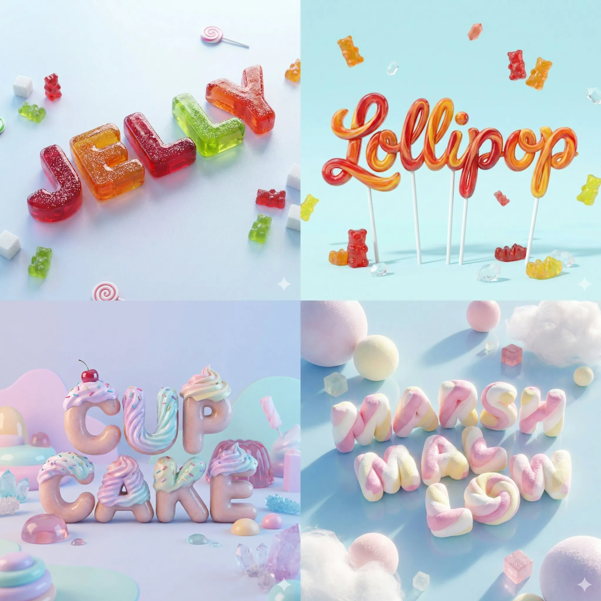

# AZIZ | AI 🇸🇦 — by @aziz4ai

[← Back to Community Examples](../../EXAMPLES.md) · Category: Illustration & 3D · Model: `Nano Banana`

<a href="https://x.com/aziz4ai/status/2009664169331839410"></a>

Source: **[@aziz4ai on X](https://x.com/aziz4ai/status/2009664169331839410)** · Creator: [AZIZ | AI 🇸🇦](https://x.com/aziz4ai)

## Prompt

```text
A smooth, ultra-realistic 3D render of the word [YOUR WORD] shaped like a delicious candy — style adapts based on word — surrounded by a minimal candy world — high-Kelvin lighting — cinematic ray tracing — soft shadows — glossy details — hyper-real textures — square format
```

## Try it

Paste the prompt into **[vinano.ai](https://vinano.ai?utm_source=github&utm_medium=readme&utm_campaign=awesome-image-video-prompts-updating&utm_content=x-page-try)** to generate your own version.

> The image and prompt belong to @aziz4ai ([original post](https://x.com/aziz4ai/status/2009664169331839410)) and are shown here with credit for reference. Creators can ask for changes or removal by opening an issue.
