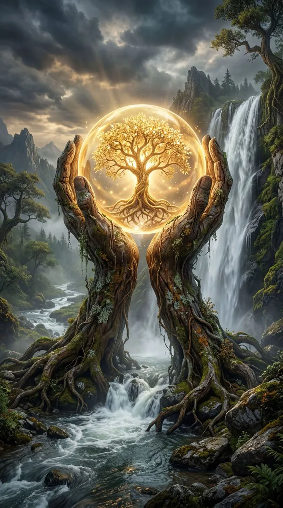

# Viki — by @churvikv

[← Back to Examples from X](../../EXAMPLES.md) · Category: Illustration & 3D · Model: `Nano Banana`

<a href="https://x.com/churvikv/status/2039728974092243121"></a>

Original post: **[@churvikv on X](https://x.com/churvikv/status/2039728974092243121)** · Creator: [Viki](https://x.com/churvikv)

## Prompt

```text
A majestic, ancient gnarled tree with thick, twisting roots sits at the center of a lush, mystical landscape, its roots anchoring into a vibrant, foaming stream flowing over moss-covered rocks. Suspended within the dense, dark green canopy of the tree is a radiant, glowing golden orb containing a detailed, ethereal silhouette of a tree of life. In the background, a massive, towering waterfall cascades down a rugged, misty cliffside into the river below. The scene is illuminated by the soft, warm light emanating from the golden orb, contrasting with the moody, overcast sky and the deep, rich greens of the surrounding forest. Photorealistic, cinematic lighting, high fantasy art style, intricate textures on the bark and water, 8k resolution.
```

## Try it

Paste the prompt into **[vinano.ai](https://vinano.ai?utm_source=github&utm_medium=readme&utm_campaign=awesome-image-video-prompts-updating&utm_content=x-page-try)** to generate your own version.

> The image and prompt belong to [@churvikv](https://x.com/churvikv) and are shown here with credit for reference. Creators can ask for changes or removal by opening an issue.
