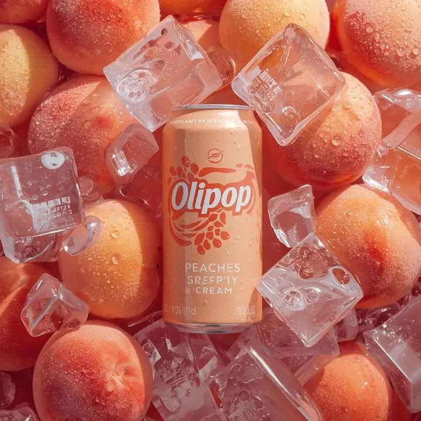

# 𝐌 — by @Strength04_X

[← Back to Community Examples](../../EXAMPLES.md) · Category: Product & Brand · Model: `Nano Banana`

<a href="https://x.com/Strength04_X/status/2022677800046797093"></a>

Source: **[@Strength04_X on X](https://x.com/Strength04_X/status/2022677800046797093)** · Creator: [𝐌](https://x.com/Strength04_X)

## Prompt

```text
Ultra-realistic commercial product photography of a pastel peach-colored soda can labeled “OLIPOP – Peaches & Cream” placed upright in the center, surrounded tightly by fresh whole peaches at the bottom and large transparent ice cubes stacked around and partially covering the top of the can, heavy condensation droplets covering the can and fruit, tiny carbonation bubbles visible on the peaches, crushed ice texture with sharp edges and frosty highlights, soft diffused studio lighting.
```

## Try it

Paste the prompt into **[vinano.ai](https://vinano.ai?utm_source=github&utm_medium=readme&utm_campaign=awesome-image-video-prompts-updating&utm_content=x-page-try)** to generate your own version.

> The image and prompt belong to @Strength04_X ([original post](https://x.com/Strength04_X/status/2022677800046797093)) and are shown here with credit for reference. Creators can ask for changes or removal by opening an issue.
