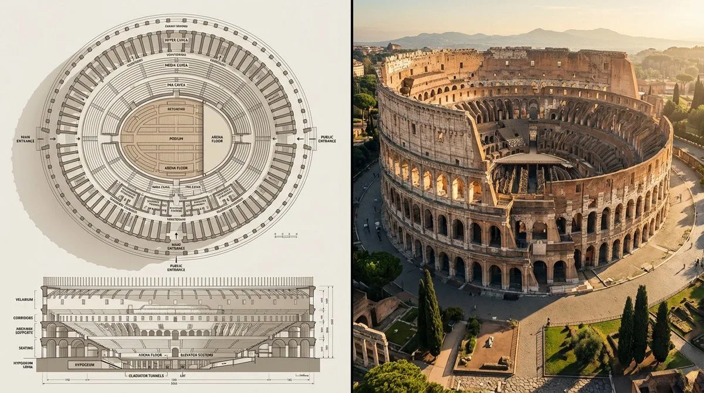

# TechieSA — by @TechieBySA

[← Back to Community Examples](../../EXAMPLES.md) · Category: Illustration & 3D · Model: `Nano Banana`

<a href="https://x.com/TechieBySA/status/2018029876356239823"></a>

Source: **[@TechieBySA on X](https://x.com/TechieBySA/status/2018029876356239823)** · Creator: [TechieSA](https://x.com/TechieBySA)

## Prompt

```text
Split composition image, left and right halves clearly divided in 16:9 widescreen format.
Left Half:
Highly detailed architectural floor plan and cross-section illustration of [LANDMARK] in a modern minimalist style. Top-down view showing main structural layout, internal divisions, circulation paths, key chambers or spaces with labels. Material callouts, structural support systems, and architectural details clearly marked. Neutral beige and warm gray color palette, clean linework, soft shadows, subtle textures. Professional architectural-presentation style. Include detailed cross-sectional diagram showing vertical layers and internal structure. Blueprint aesthetic with technical accuracy and labeled sections.
Right Half:
Ultra-realistic aerial exterior photograph of [LANDMARK] captured from above and to the side (elevated isometric perspective, not straight overhead). Shows the complete structure with authentic weathered textures, aged materials, surrounding landscape, dramatic golden-hour sunlight creating sharp shadows, atmospheric haze suggesting historical significance. The perspective reveals both external grandeur and internal scale simultaneously. Warm golden-light lighting, realistic patina and wear patterns, authentic architectural proportions. Feels like an aerial photograph capturing the monument’s true majesty and scale.
Both halves align visually, clearly showing architectural engineering blueprint vs. the actual monumental structure in its archaeological or historical reality.
Style & Mood:
•Architectural blueprint visualization meets historical aerial photography
•Engineering precision and historical significance
•Educational, museum-exhibit presentation
•Engineering schematic-to-reality comparison
•Grandeur emphasizing scale and architectural sophistication
Lighting & Color:
•Left: Flat, even lighting, neutral blueprint tones, technical aesthetic
•Right: Golden-hour natural light, dramatic shadows, warm tones, atmospheric depth
•Consistent warm palette between both halves
Camera & Technical Details:
•Left: Top-down orthographic + detailed cross-sectional architectural view with labeled sections
•Right: Elevated aerial perspective (45-degree isometric angle), capturing full structure from above-and-to-the-side
•High resolution, sharp architectural details on left; photorealistic weathered textures on right
Negative Prompt:
Cartoon style, low detail, cluttered composition, modern elements, unrealistic proportions, harsh lighting, exaggerated colors, text overlays, watermarks, CGI look, sterile rendering, straight-down overhead view, no atmospheric quality, overly pristine condition
```

## Try it

Paste the prompt into **[vinano.ai](https://vinano.ai?utm_source=github&utm_medium=readme&utm_campaign=awesome-image-video-prompts-updating&utm_content=x-page-try)** to generate your own version.

> The image and prompt belong to @TechieBySA ([original post](https://x.com/TechieBySA/status/2018029876356239823)) and are shown here with credit for reference. Creators can ask for changes or removal by opening an issue.
