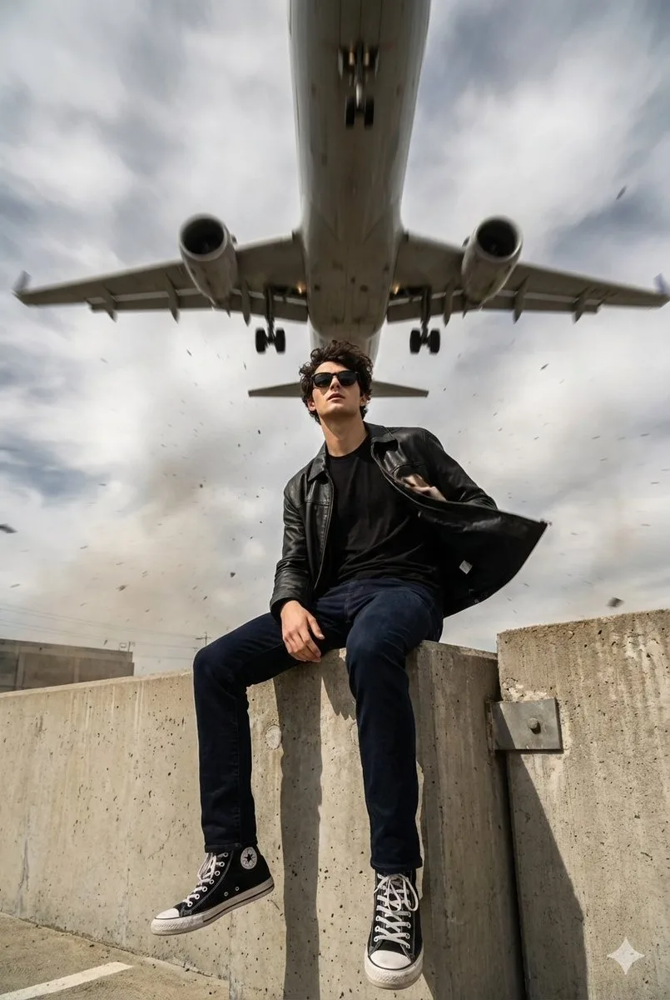

# Harboriis — by @harboriis

[← Back to Community Examples](../../EXAMPLES.md) · Category: Photography · Model: `Nano Banana`

<a href="https://x.com/harboriis/status/2015354198670606808"></a>

Source: **[@harboriis on X](https://x.com/harboriis/status/2015354198670606808)** · Creator: [Harboriis](https://x.com/harboriis)

## Prompt

```text
Create an ultra-realistic cinematic 8K portrait, use face reference exactly (100% identical, no changes) - preserve original facial features, proportions, skin texture, hair, and expressions. A man wearing black sunglasses, a black t-shirt, black leather jacket, dark denim pants, and black Converse-style sneakers sits casually on a concrete ledge. One leg is bent while the other hangs freely. His posture is relaxed, projecting calm confidence. A massive airplane flies extremely low overhead, dominating the sky. Powerful wind ripples his jacket and clothing. Captured with a wide-angle lens from a low perspective, creating dramatic scale. Motion blur appears in clouds, debris, and air turbulence, enhancing speed and intensity. Lighting is natural and cinematic with strong contrast. The atmosphere feels surreal yet realistic, emphasizing depth, movement, and cinematic tension.
```

## Try it

Paste the prompt into **[vinano.ai](https://vinano.ai?utm_source=github&utm_medium=readme&utm_campaign=awesome-image-video-prompts-updating&utm_content=x-page-try)** to generate your own version.

> The image and prompt belong to @harboriis ([original post](https://x.com/harboriis/status/2015354198670606808)) and are shown here with credit for reference. Creators can ask for changes or removal by opening an issue.
