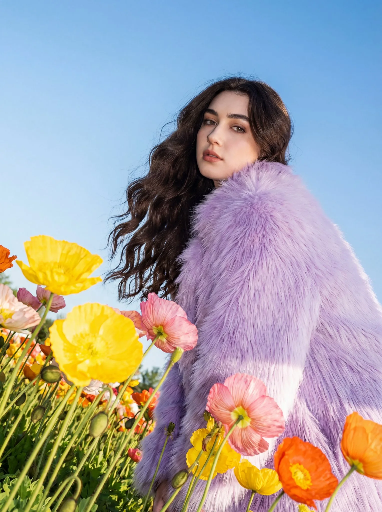

# Zara — by @ZaraIrahh

[← Back to Community Examples](../../EXAMPLES.md) · Category: Photography · Model: `Nano Banana`

<a href="https://x.com/ZaraIrahh/status/2009073223758238007"></a>

Source: **[@ZaraIrahh on X](https://x.com/ZaraIrahh/status/2009073223758238007)** · Creator: [Zara](https://x.com/ZaraIrahh)

## Prompt

```text
Use this photo attached to create a striking outdoor fashion portrait set in a vibrant flower field during daylight, captured with a digital camera using a harsh flash. The camera angle is low and slightly tilted upward, intensifying the scene's energy and drama. The subject has long, loose, dark brown wavy hair cascading over a voluminous, soft, shaggy lavender faux fur coat that drapes naturally over the body. Surrounding the subject are large, colorful poppies in yellow, pink, and orange, some in the foreground and others in the background, creating an immersive field-of-flowers effect. The sky is clear and blue, providing a crisp, contrasting backdrop. The mood is bold, editorial, and whimsical, making the vibrant colors of the outfit and flowers pop starkly against the serene sky. The overall composition should evoke a playful yet high-fashion atmosphere with a hint of surrealism, emphasizing texture and color through the use of direct flash photography.
```

## Try it

Paste the prompt into **[vinano.ai](https://vinano.ai?utm_source=github&utm_medium=readme&utm_campaign=awesome-image-video-prompts-updating&utm_content=x-page-try)** to generate your own version.

> The image and prompt belong to @ZaraIrahh ([original post](https://x.com/ZaraIrahh/status/2009073223758238007)) and are shown here with credit for reference. Creators can ask for changes or removal by opening an issue.
