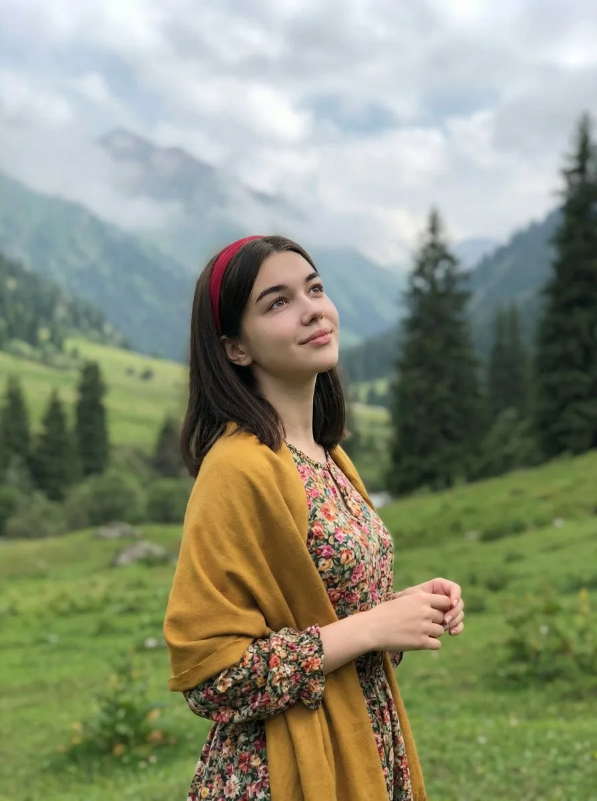

# 𝗦𝗮𝗻𝗶𝗮 — by @saniaspeaks_

[← Back to Community Examples](../../EXAMPLES.md) · Category: Photography · Model: `Nano Banana`

<a href="https://x.com/saniaspeaks_/status/2026450660540010760"></a>

Source: **[@saniaspeaks_ on X](https://x.com/saniaspeaks_/status/2026450660540010760)** · Creator: [𝗦𝗮𝗻𝗶𝗮](https://x.com/saniaspeaks_)

## Prompt

```text
{
  "image_generation": {
    "subject": {
      "description": "young woman standing in a lush green mountain valley",
      "pose": "standing naturally with hands gently together, looking slightly upward",
      "expression": "calm, peaceful, soft smile",
      "gaze": "looking toward the sky"
    },
    "appearance": {
      "hair": {
        "color": "dark brown",
        "style": "straight, shoulder-length with a red headband"
      },
      "face": {
        "skin_tone": "fair and natural",
        "makeup": "minimal, natural makeup"
      }
    },
    "outfit": {
      "top": "traditional patterned dress with colorful floral design",
      "outerwear": "mustard yellow shawl draped over shoulders"
    },
    "environment": {
      "setting": "green mountainous landscape",
      "background_elements": [
        "rolling green hills",
        "tall pine trees",
        "misty mountains",
        "cloudy sky",
        "grassy field"
      ]
    },
    "lighting": {
      "type": "natural outdoor light",
      "quality": "soft and diffused",
      "time": "daytime"
    },
    "camera": {
      "angle": "eye-level",
      "framing": "mid shot",
      "depth_of_field": "moderate, background softly blurred"
    },
    "aesthetic": {
      "style": "natural lifestyle photography",
      "vibe": "peaceful, fresh, scenic",
      "color_palette": "green, mustard yellow, earthy tones"
    },
    "quality": {
      "resolution": "high",
      "realism": "photorealistic",
      "detail": "high detail"
    }
  }
}
```

## Try it

Paste the prompt into **[vinano.ai](https://vinano.ai?utm_source=github&utm_medium=readme&utm_campaign=awesome-image-video-prompts-updating&utm_content=x-page-try)** to generate your own version.

> The image and prompt belong to @saniaspeaks_ ([original post](https://x.com/saniaspeaks_/status/2026450660540010760)) and are shown here with credit for reference. Creators can ask for changes or removal by opening an issue.
