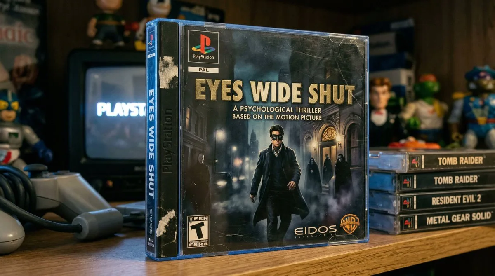

# Christopher Fryant — by @cfryant

[← Back to Examples from X](../../EXAMPLES.md) · Category: Product & Brand · Model: `Nano Banana`

<a href="https://x.com/cfryant/status/2027082459893145913"></a>

Original post: **[@cfryant on X](https://x.com/cfryant/status/2027082459893145913)** · Creator: [Christopher Fryant](https://x.com/cfryant)

## Prompt

```text
playstation 1 game case with a movie tie-in game that seems like a real game you may have played back in the day.

Pick a period appropriate movie that never got a video game version because that would have been a really bad idea. Worst possible choice for a movie tie-in game.
```

## Try it

Paste the prompt into **[vinano.ai](https://vinano.ai?utm_source=github&utm_medium=readme&utm_campaign=awesome-image-video-prompts-updating&utm_content=x-page-try)** to generate your own version.

> The image and prompt belong to [@cfryant](https://x.com/cfryant) and are shown here with credit for reference. Creators can ask for changes or removal by opening an issue.
