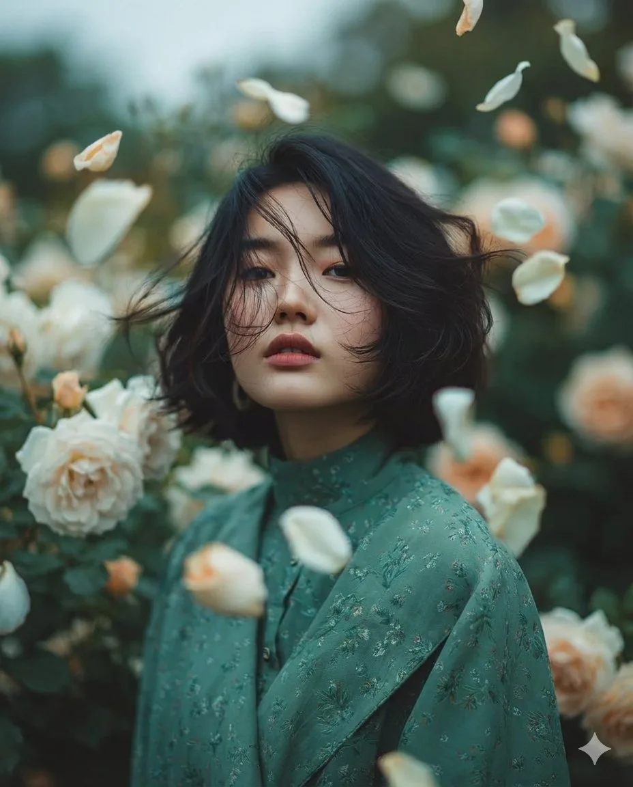

# Taaruk — by @Taaruk_

[← Back to Examples from X](../../EXAMPLES.md) · Category: Photography · Model: `Nano Banana`

<a href="https://x.com/Taaruk_/status/2009183590035411178"></a>

Original post: **[@Taaruk_ on X](https://x.com/Taaruk_/status/2009183590035411178)** · Creator: [Taaruk](https://x.com/Taaruk_)

## Prompt

```text
{
  "Objective": "Create a dreamy fine-art portrait with a romantic, ethereal garden atmosphere",
  "PersonaDetails": {
    "Subject": {
      "Type": "Young woman",
      "Hair": "Short, softly tousled dark hair",
      "Expression": "Calm, introspective, slightly melancholic",
      "Gaze": "Looking gently toward the camera",
      "Wardrobe": {
        "Dress": "Muted teal floral dress with subtle vintage patterns"
      }
    }
  },
  "SceneDescription": {
    "Location": "Lush garden in full bloom",
    "EnvironmentDetails": [
      "Abundant flowering plants",
      "Soft greenery filling the frame"
    ],
    "AtmosphericElements": {
      "FloatingPetals": "White and pale peach flower petals drifting through the air",
      "Motion": "Petals caught mid-motion by a gentle breeze"
    }
  },
  "Composition": {
    "Framing": "Waist-up fine-art portrait",
    "Balance": "Elegant, centered composition",
    "DepthOfField": "Shallow depth of field",
    "Background": "Softly blurred garden with creamy bokeh"
  },
  "LightingAndColor": {
    "Lighting": "Soft natural light under overcast sky",
    "ColorPalette": [
      "Muted greens",
      "Soft teals",
      "Pale peach and white accents"
    ],
    "ColorGrading": "Painterly, desaturated, romantic tones"
  },
  "ArtDirection": {
    "Style": "Fine-art photography blended with cinematic realism",
    "Aesthetic": "Romantic, ethereal, timeless",
    "TextureQuality": "Ultra-detailed fabric and natural skin texture"
  },
  "PhotographyStyle": {
    "LensLook": "85mm lens perspective",
    "Genre": "Fine-art portrait photography",
    "ImageQuality": "High resolution, refined detail",
    "FocusStyle": "Soft yet precise subject focus"
  },
  "Mood": {
    "Tone": "Dreamy, reflective, poetic",
    "EmotionalFeel": "Gentle melancholy and quiet beauty"
  },
  "NegativePrompt": [
    "harsh lighting",
    "modern fashion editorial",
    "oversaturated colors",
    "busy background",
    "plastic skin",
    "cartoon",
    "anime"
  ],
  "ResponseFormat": {
    "Type": "Single image",
    "Orientation": "Portrait",
    "AspectRatio": "2:3"
  }
}
```

## Try it

Paste the prompt into **[vinano.ai](https://vinano.ai?utm_source=github&utm_medium=readme&utm_campaign=awesome-image-video-prompts-updating&utm_content=x-page-try)** to generate your own version.

> The image and prompt belong to [@Taaruk_](https://x.com/Taaruk_) and are shown here with credit for reference. Creators can ask for changes or removal by opening an issue.
