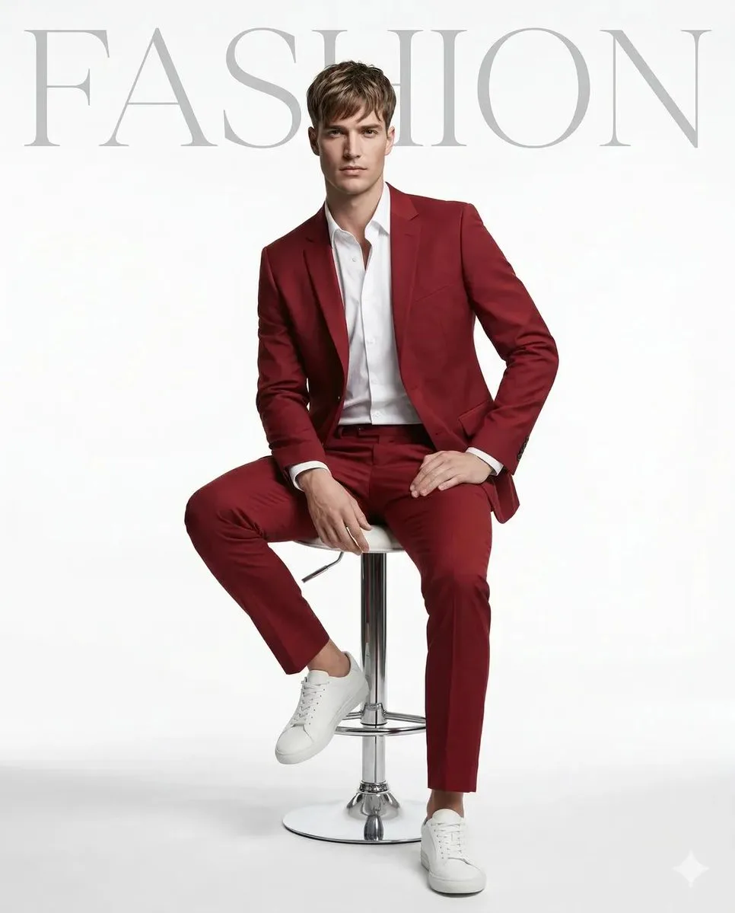

# K — by @ChillaiKalan__

[← Back to Examples from X](../../EXAMPLES.md) · Category: Product & Brand · Model: `Nano Banana`

<a href="https://x.com/ChillaiKalan__/status/2036659588259553747"></a>

Original post: **[@ChillaiKalan__ on X](https://x.com/ChillaiKalan__/status/2036659588259553747)** · Creator: [K](https://x.com/ChillaiKalan__)

## Prompt

```text
Create an ultra-photorealistic studio portrait using the uploaded image as the ONLY identity reference. The subject must retain exact facial identity — same facial structure, proportions, skin tone, hairstyle, and natural features. Do not alter or beautify the face.
The subject is wearing a sharply tailored,
```

## Try it

Paste the prompt into **[vinano.ai](https://vinano.ai?utm_source=github&utm_medium=readme&utm_campaign=awesome-image-video-prompts-updating&utm_content=x-page-try)** to generate your own version.

> The image and prompt belong to [@ChillaiKalan__](https://x.com/ChillaiKalan__) and are shown here with credit for reference. Creators can ask for changes or removal by opening an issue.
