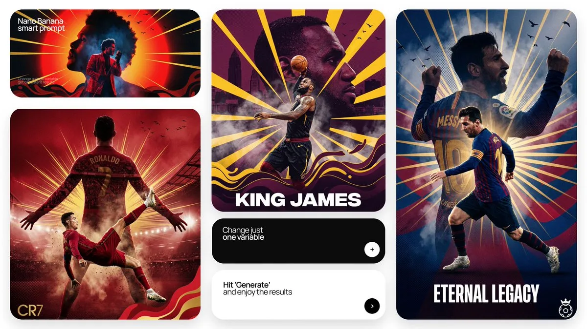

# AmirMušić — by @AmirMushich

[← Back to Examples from X](../../EXAMPLES.md) · Category: Poster Design · Model: `Nano Banana`

<a href="https://x.com/AmirMushich/status/2025631713729106049"></a>

Original post: **[@AmirMushich on X](https://x.com/AmirMushich/status/2025631713729106049)** · Creator: [AmirMušić](https://x.com/AmirMushich)

## Prompt

```text
[PERSONE]. Act as a Senior Art Director.

PHASE 1: PHOTOGRAPHIC COMPOSITION.

- Layered Effect: Double exposure photographic collage. High-definition action shot in the foreground; massive monumental silhouette in the background.

- Overlap: The subject must seamlessly integrate with the background graphics.

PHASE 2: CONTEXTUAL VIBE SIMULATION.

- Identity Analysis: Autonomously identify the core industry of [PERSONE] (Sport, Music, Cinema, or Business).

- Pose & Props: 

PHASE 3: DYNAMIC COLOR & BRAND SIMULATION (VARIABLE COLORS).

- Primary Color (Atmosphere): Identify the MOST ICONIC color associated with [PERSONE] or their team/brand. Use this for the background, halftone textures, and smoke.

- Accent Color (Impact): Identify a secondary high-contrast VIBRANT hue (e.g., neon, gold, or electric white). Use this for the "Radial Burst" rays.

- Visual Texture: Apply heavy film grain and halftone dots (screen printing effect) to the shadows of the high-res photos.

PHASE 4: GRAPHIC ACCENTS.

- Geometry: Bold radial rays bursting from the center. Fluid, wave-like organic shapes at the base.

- Birds: Minimalist black bird silhouettes for scale and depth.

PHASE 5: BRANDING & TEXT.

- Tagline: Generate a powerful, one-word or two-word slogan tailored to [PERSONE]'s legacy.

- Logo: Place a minimalist, industry-appropriate logo in the bottom corner.

- Typography: Bold, high-impact Sans-Serif.

TECHNICAL FINISH:

- Quality: 8k resolution, authentic commercial photography style (NOT an illustration). 

- Lighting: Extreme studio rim-lighting (contour highlights) to separate the photographic subjects from the graphic layers.
```

## Try it

Paste the prompt into **[vinano.ai](https://vinano.ai?utm_source=github&utm_medium=readme&utm_campaign=awesome-image-video-prompts-updating&utm_content=x-page-try)** to generate your own version.

> The image and prompt belong to [@AmirMushich](https://x.com/AmirMushich) and are shown here with credit for reference. Creators can ask for changes or removal by opening an issue.
