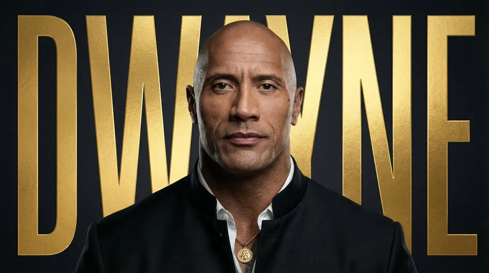

# Shushant Lakhyani — by @shushant_l

[← Back to Examples from X](../../EXAMPLES.md) · Category: Photography · Model: `Nano Banana`

<a href="https://x.com/shushant_l/status/2032819113308074313"></a>

Original post: **[@shushant_l on X](https://x.com/shushant_l/status/2032819113308074313)** · Creator: [Shushant Lakhyani](https://x.com/shushant_l)

## Prompt

```text
ultra realistic cinematic portrait poster of a confident man using the attached face image as reference, centered headshot with shoulders visible and a calm powerful expression. Use dramatic studio lighting with a soft key light and subtle rim lighting for depth and contrast. The background should be dark matte black or charcoal with a luxury cinematic feel. Place very large tall condensed vertical typography behind the subject in the same stretched style as the reference image, partially hidden by the subject, with the text placeholder “[INSERT TITLE TEXT HERE]”. The typography should be metallic gold with a subtle foil shine. Dress the subject in a refined masculine outfit such as a black tailored suit or elegant modern sherwani. Style the image as a classy luxury editorial poster with deep black and gold tones, ultra realistic skin detail, shallow depth of field, cinematic color grading, and high resolution professional photography
```

## Try it

Paste the prompt into **[vinano.ai](https://vinano.ai?utm_source=github&utm_medium=readme&utm_campaign=awesome-image-video-prompts-updating&utm_content=x-page-try)** to generate your own version.

> The image and prompt belong to [@shushant_l](https://x.com/shushant_l) and are shown here with credit for reference. Creators can ask for changes or removal by opening an issue.
