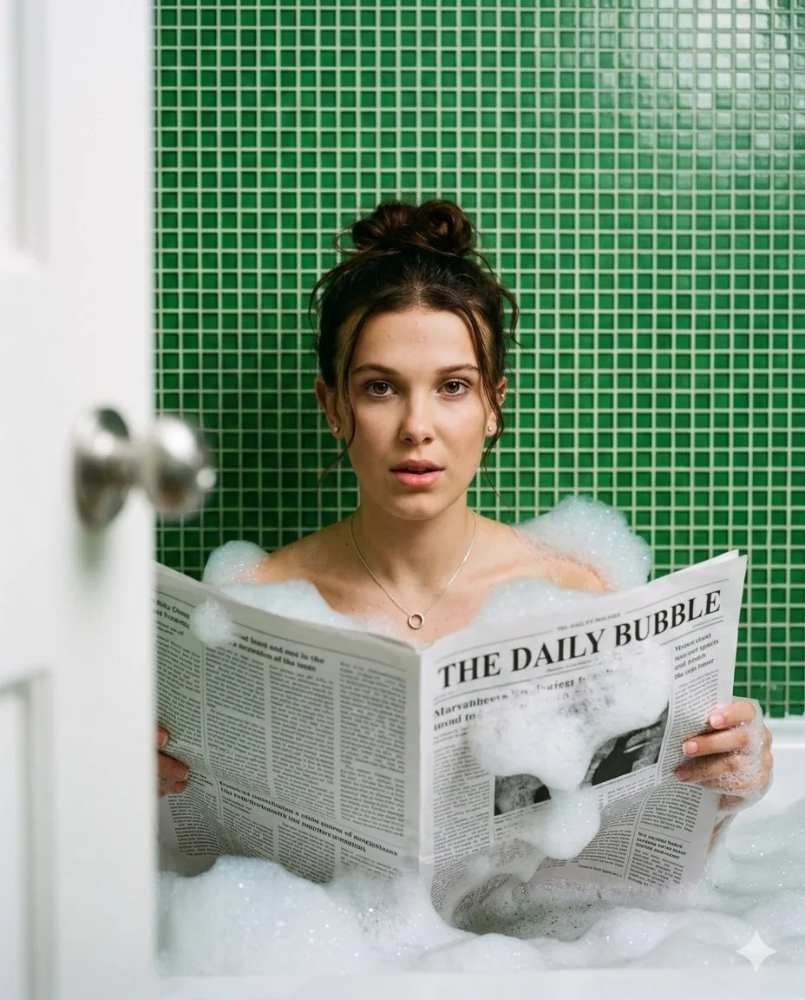

# Giulia — by @Giulia_4i

[← Back to Community Examples](../../EXAMPLES.md) · Category: Photography · Model: `Nano Banana`

<a href="https://x.com/Giulia_4i/status/2032817549813969039"></a>

Source: **[@Giulia_4i on X](https://x.com/Giulia_4i/status/2032817549813969039)** · Creator: [Giulia](https://x.com/Giulia_4i)

## Prompt

```text
A young blonde Hollywood actress, similar to Sydney Sweeney, appears inside a bathtub filled with foam up to the brim. Her blonde hair is styled in a high, voluminous, slightly messy bun, with a few loose strands softly framing her face. She looks directly at the camera with a neutral, subtly seductive expression, her lips slightly parted. She wears light, natural makeup, a delicate silver chain necklace with a small circular pendant, and small, discreet stud earrings.

Her upper body faces forward, visible above the foam. She holds a large open printed newspaper with both hands at chest height, as if reading it. The newspaper is partially covered with dense white soap foam, which also gathers around her in thick, fluffy bubbles filling the bathtub. Beneath the foam and the newspaper, she is wearing a green beach top that remains completely hidden.

The scene takes place inside a tiled bathtub. In the background, there is a vibrant wall completely covered with small, bright yellow square mosaic tiles. In the left corner of the composition, a slightly out-of-focus white door frame is visible, with a silver metallic doorknob.

The lighting is soft, diffused, and even indoor lighting, coming from the front and slightly from above. It creates soft, flattering highlights on her face, shoulders, and hair, with very few harsh shadows. The image conveys an eccentric, artistic, editorial atmosphere that feels slightly surreal, yet calm and visually striking.

The color palette highlights the bright yellow tiles, the white foam, the blonde hair, and the gray tones of the newspaper. The photograph is a modern, photorealistic editorial portrait with cinematic framing. The composition is a medium shot from the upper bust upward, at eye level, with a shallow depth of field that keeps the actress and the newspaper in sharp focus while slightly blurring the door handle in the foreground. The image is highly detailed, with crisp focus, professional lighting, vibrant high-contrast colors, and extremely high quality in 8K resolution, in a 4:5 aspect ratio.
```

## Try it

Paste the prompt into **[vinano.ai](https://vinano.ai?utm_source=github&utm_medium=readme&utm_campaign=awesome-image-video-prompts-updating&utm_content=x-page-try)** to generate your own version.

> The image and prompt belong to @Giulia_4i ([original post](https://x.com/Giulia_4i/status/2032817549813969039)) and are shown here with credit for reference. Creators can ask for changes or removal by opening an issue.
