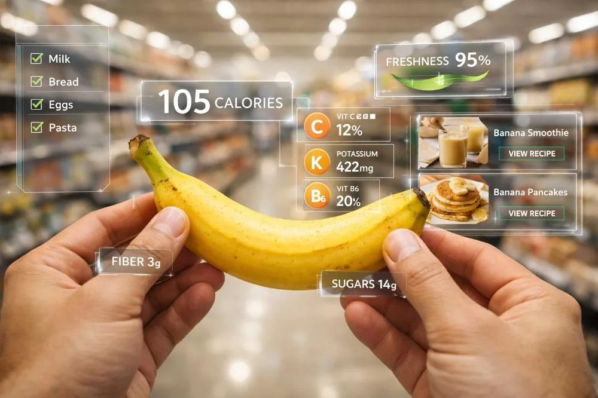

# Taaruk — by @Taaruk_

[← Back to Community Examples](../../EXAMPLES.md) · Category: Food & Drink · Model: `Nano Banana`

<a href="https://x.com/Taaruk_/status/2016421696299991337"></a>

Source: **[@Taaruk_ on X](https://x.com/Taaruk_/status/2016421696299991337)** · Creator: [Taaruk](https://x.com/Taaruk_)

## Prompt

```text
{
  "image_prompt": {
    "viewpoint": "Realistic first-person view (FPV)",
    "action": "Person holding fresh fruit in their hands",
    "subject_variations": [
      "Banana",
      "Strawberries",
      "Apple"
    ],
    "environment": {
      "location": "Modern supermarket aisle",
      "background": "Blurred grocery shelves",
      "lighting": "Bright commercial lighting"
    },
    "augmented_reality_hud": {
      "overlay_style": "Clean sci-fi interface, soft glow, glass-like UI elements",
      "data_display": [
        "Nutritional data (calories, vitamins, fiber, sugars, potassium)",
        "Freshness percentage",
        "Health indicators"
      ],
      "ui_panels": [
        "Checklist items (milk, bread, eggs, pasta)",
        "Recipe suggestions",
        "Smoothie options",
        "Vitamin icons"
      ],
      "visual_effects": "Subtle light particles, depth-aware AR placement"
    },
    "technical_specs": {
      "style": "Ultra-realistic photography blended with futuristic AR technology",
      "aesthetic": "Modern health-tech",
      "focus": "Sharp focus on hands and fruit, shallow depth of field",
      "resolution": "8K",
      "realism": "Cinematic realism"
    }
  }
}
```

## Try it

Paste the prompt into **[vinano.ai](https://vinano.ai?utm_source=github&utm_medium=readme&utm_campaign=awesome-image-video-prompts-updating&utm_content=x-page-try)** to generate your own version.

> The image and prompt belong to @Taaruk_ ([original post](https://x.com/Taaruk_/status/2016421696299991337)) and are shown here with credit for reference. Creators can ask for changes or removal by opening an issue.
