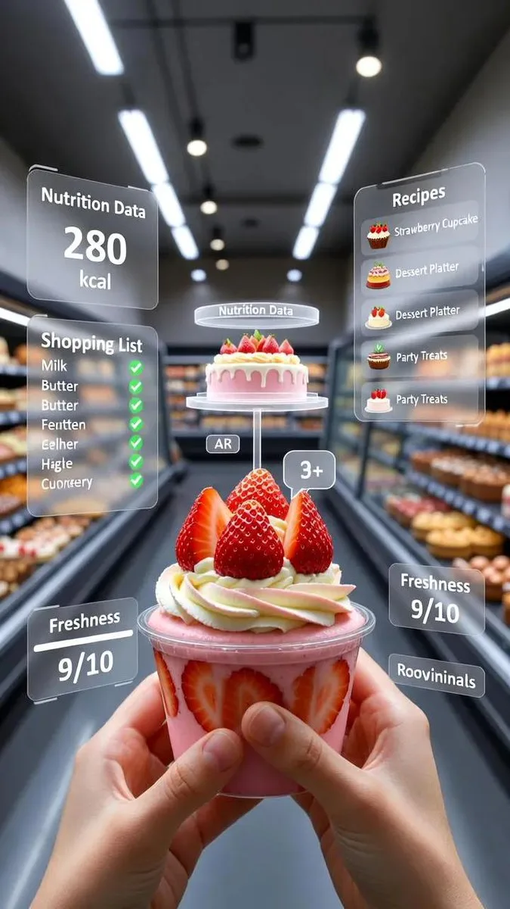

# 𝐌 — by @Strength04_X

[← Back to Community Examples](../../EXAMPLES.md) · Category: Product & Brand · Model: `Nano Banana`

<a href="https://x.com/Strength04_X/status/2015794054110552310"></a>

Source: **[@Strength04_X on X](https://x.com/Strength04_X/status/2015794054110552310)** · Creator: [𝐌](https://x.com/Strength04_X)

## Prompt

```text
A first-person point-of-view (POV) shot inside a modern supermarket aisle. The viewer's hands are holding a mixed fruit jam jar with colorful branding, showing a blend of strawberry, blueberry, and orange flavors. Floating around the jar are sleek, semi-transparent Augmented Reality (AR) digital interfaces and holographic HUDs. The overlays display "Flavor Mix" with fruit icons, "Nutrition Info," and a glowing "Freshness Meter" reading 9/10. A digital shopping list with checkmarks for bread and butter appears beside the jar, along with small recipe suggestions like breakfast toast, pancakes, and desserts. The background shelves are slightly blurred with other products and shoppers, creating realistic depth of field. Bright, clean lighting with a futuristic retail atmosphere, ultra-realistic, cinematic look, high-tech AR glasses perspective, vertical composition.
```

## Try it

Paste the prompt into **[vinano.ai](https://vinano.ai?utm_source=github&utm_medium=readme&utm_campaign=awesome-image-video-prompts-updating&utm_content=x-page-try)** to generate your own version.

> The image and prompt belong to @Strength04_X ([original post](https://x.com/Strength04_X/status/2015794054110552310)) and are shown here with credit for reference. Creators can ask for changes or removal by opening an issue.
