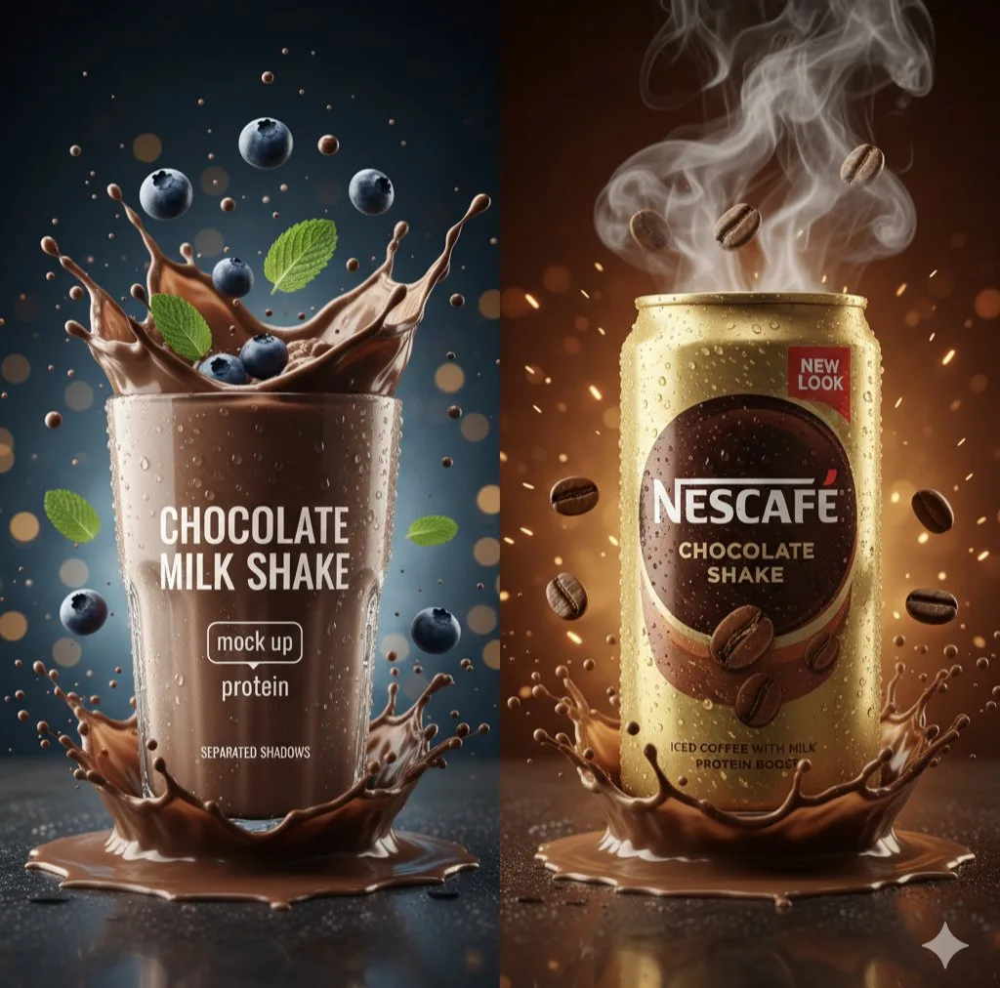

# Minahil — by @Minahil42298354

[← Back to Examples from X](../../EXAMPLES.md) · Category: Food & Drink · Model: `Nano Banana`

<a href="https://x.com/Minahil42298354/status/2019630789474861400"></a>

Original post: **[@Minahil42298354 on X](https://x.com/Minahil42298354/status/2019630789474861400)** · Creator: [Minahil](https://x.com/Minahil42298354)

## Prompt

```text
{
  "master_prompt": {
    "global_settings": {
      "style": "Hyper-realistic commercial product photography", 
      "layout": "Vertical split-screen, two distinct modules",
      "resolution": "8K UHD, cinematic lighting",
      "details": "Extreme clarity, frozen motion splashes, micro-condensation"
    },
    "module_1_left": {
      "subject": {
        "type": "Clear tall glass of thick chocolate milkshake",
        "details": "Frothy texture, visible condensation on glass",
        "text_on_glass": ["CHOCOLATE MILK SHAKE", "mock up", "protein"]
      },
      "action": "Dynamic chocolate liquid splash erupting from the base and top",
      "floating_elements": [
        "Whole blueberries with water droplets",
        "Fresh green mint leaves",
        "Tiny chocolate particles suspended in air"
      ],
      "background": {
        "color": "Deep dark blue with soft golden bokeh particles",
        "lighting": "Cool moonlight-style rim lighting"
      }
    },
    "module_2_right": {
      "subject": {
        "type": "Slim gold metallic Nescafé can",
        "details": "Heavy condensation, matte gold finish",
        "text_on_can": ["NESCAFÉ", "CHOCOLATE SHAKE", "NEW LOOK", "PROTEIN BOOST"]
      },
      "action": "Explosive chocolate liquid crown splash at the base",
      "floating_elements": [
        "Roasted coffee beans",
        "Swirling thick white steam/smoke rising from the top",
        "Glowing amber embers and sparks"
      ],
      "background": {
        "color": "Warm chocolate brown to dark amber gradient",
        "atmosphere": "Moody, intense, and smoky"
      }
    },
    "surface_details": {
      "base": "Reflective dark wet surface with liquid pooling",
      "shadows": "Soft separated realistic shadows"
    }
  }
}
```

## Try it

Paste the prompt into **[vinano.ai](https://vinano.ai?utm_source=github&utm_medium=readme&utm_campaign=awesome-image-video-prompts-updating&utm_content=x-page-try)** to generate your own version.

> The image and prompt belong to [@Minahil42298354](https://x.com/Minahil42298354) and are shown here with credit for reference. Creators can ask for changes or removal by opening an issue.
