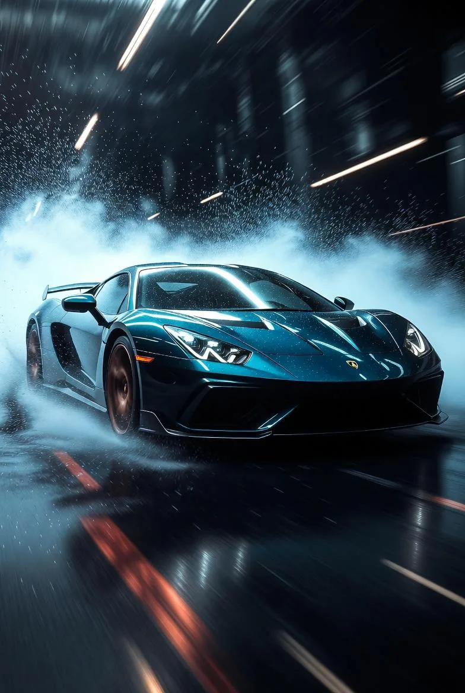

# 𝐌 — by @Strength04_X

[← Back to Examples from X](../../EXAMPLES.md) · Category: Product & Brand · Model: `Nano Banana`

<a href="https://x.com/Strength04_X/status/2020318286538473577"></a>

Original post: **[@Strength04_X on X](https://x.com/Strength04_X/status/2020318286538473577)** · Creator: [𝐌](https://x.com/Strength04_X)

## Prompt

```text
Hyper-realistic cinematic product photograph of a luxury sports car front three-quarter view, glossy paint reflecting sharp highlights. Water mist and rain droplets explode around the car in frozen motion, light streaks emphasizing speed. Dramatic studio lighting with strong rim light and soft fill, shallow depth of field, ultra-sharp focus, dark minimal background, premium automotive advertising realism.
```

## Try it

Paste the prompt into **[vinano.ai](https://vinano.ai?utm_source=github&utm_medium=readme&utm_campaign=awesome-image-video-prompts-updating&utm_content=x-page-try)** to generate your own version.

> The image and prompt belong to [@Strength04_X](https://x.com/Strength04_X) and are shown here with credit for reference. Creators can ask for changes or removal by opening an issue.
