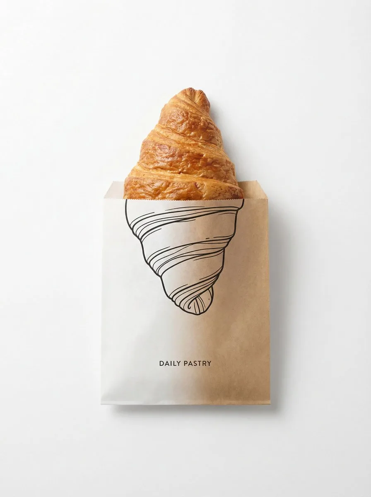

# Ege — by @egeberkina

[← Back to Community Examples](../../EXAMPLES.md) · Category: Food & Drink · Model: `Nano Banana`

<a href="https://x.com/egeberkina/status/2034640645877321998"></a>

Source: **[@egeberkina on X](https://x.com/egeberkina/status/2034640645877321998)** · Creator: [Ege](https://x.com/egeberkina)

## Prompt

```text
minimal studio shot on pure white background, real [Food Name] emerging from a paper packaging, the visible part outside the packaging is fully photorealistic, the continuation of the same food is drawn as a clean black line illustration printed directly on the surface of the packaging, perfectly aligned with the real food shape, the illustration stays strictly on the packaging material, not floating, not extending into the background, seamless transition between real and printed illustration, modern minimal branding, top-down composition, soft shadows
```

## Try it

Paste the prompt into **[vinano.ai](https://vinano.ai?utm_source=github&utm_medium=readme&utm_campaign=awesome-image-video-prompts-updating&utm_content=x-page-try)** to generate your own version.

> The image and prompt belong to @egeberkina ([original post](https://x.com/egeberkina/status/2034640645877321998)) and are shown here with credit for reference. Creators can ask for changes or removal by opening an issue.
