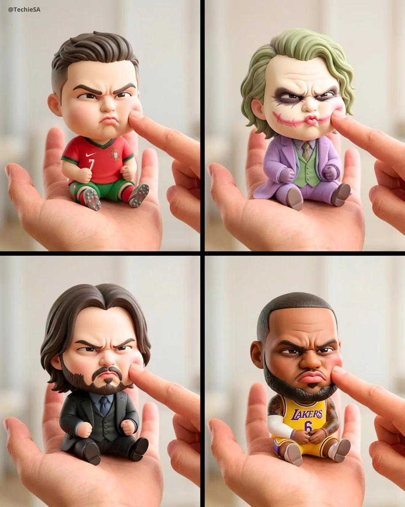

# TechieSA — by @TechieBySA

[← Back to Community Examples](../../EXAMPLES.md) · Category: Illustration & 3D · Model: `Nano Banana`

<a href="https://x.com/TechieBySA/status/2029563473592504682"></a>

Source: **[@TechieBySA on X](https://x.com/TechieBySA/status/2029563473592504682)** · Creator: [TechieSA](https://x.com/TechieBySA)

## Prompt

```text
A mini chibi version of the character in the uploaded image, with a big head and small body, sitting on an open left palm for realistic scale. A right hand gently pressing its cheek with an index finger. The character looks annoyed and pouty — puffed cheeks, slightly frowning, squinting eyes. Ultra-detailed chibi style, soft pastel colors, smooth texture, clean lighting, shallow depth of field, strong focus on facial expression and hand interaction, vertical composition 4:5 ratio.​​​​​​​​​​​​​​​​
```

## Try it

Paste the prompt into **[vinano.ai](https://vinano.ai?utm_source=github&utm_medium=readme&utm_campaign=awesome-image-video-prompts-updating&utm_content=x-page-try)** to generate your own version.

> The image and prompt belong to @TechieBySA ([original post](https://x.com/TechieBySA/status/2029563473592504682)) and are shown here with credit for reference. Creators can ask for changes or removal by opening an issue.
