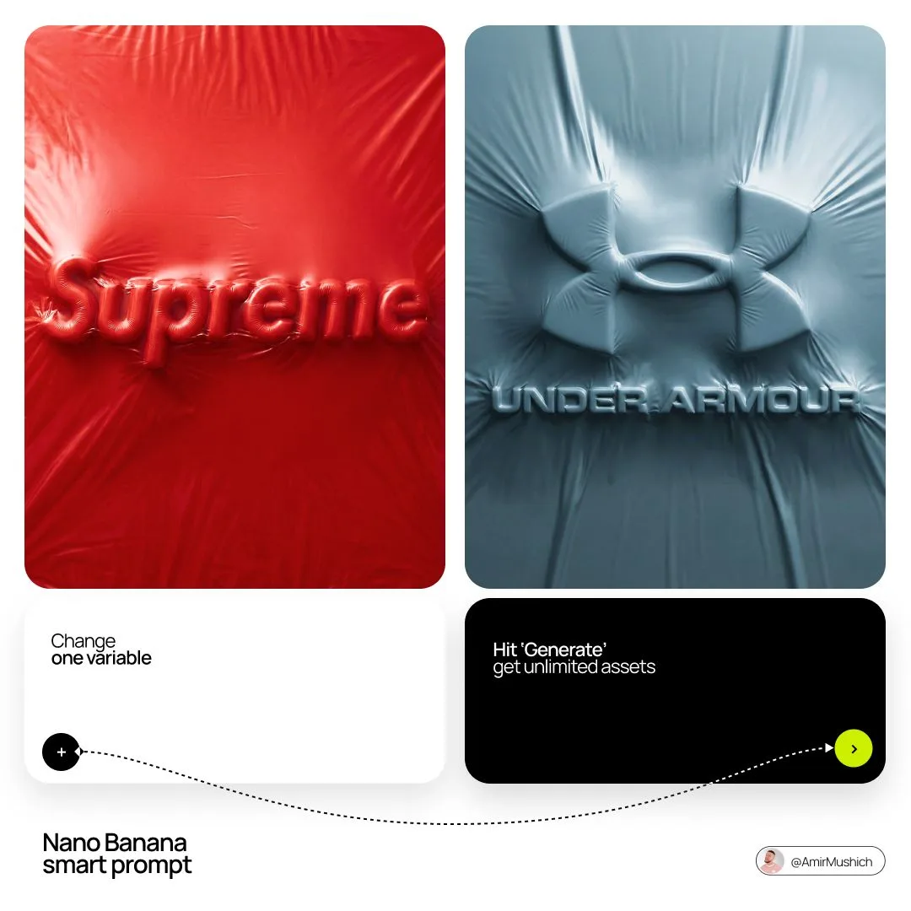

# AmirMušić — by @AmirMushich

[← Back to Community Examples](../../EXAMPLES.md) · Category: Product & Brand · Model: `Nano Banana`

<a href="https://x.com/AmirMushich/status/2039404183250522151"></a>

Source: **[@AmirMushich on X](https://x.com/AmirMushich/status/2039404183250522151)** · Creator: [AmirMušić](https://x.com/AmirMushich)

## Prompt

```text
[BRAND NAME] + [COLOR]

Act as a Senior CGI Artist specializing in shrink wrap simulation and 3D material rendering. Your task: render [BRAND NAME]'s complete logo — icon mark AND wordmark if the brand uses one — completely wrapped under a single layer of tight stretched plastic film or shrink wrap. The logo forms are visible only as raised shapes beneath the material, never exposed directly.

BRAND INTELLIGENCE SYSTEM

Before executing, resolve: (1) LOGO GEOMETRY — identify [BRAND NAME]'s complete visual identity mark — this includes both the icon symbol AND the wordmark/logotype if the brand uses them together. Render both elements as they appear in the brand's official lockup. If the brand uses only an icon with no wordmark, render the icon only. If the brand uses a wordmark without an icon, render the wordmark only. Preserve the correct spatial relationship between icon and text as it appears in the real logo, (2) COLOR SYSTEM — based on [COLOR], determine one single monochromatic tone that covers everything in the scene without exception — the wrapped object, the background surface, the film material — pure tonal unity with variation only through light and shadow, (3) FILM CHARACTER — based on [COLOR] determine the stretch film behavior: bright saturated colors become tight latex or glossy shrink wrap with visible tension lines, neutrals become matte stretch film like packaging plastic, darks become semi-transparent vacuum seal film, light colors become frosted cling wrap.

PHASE 1: SCENE & SURFACE

The entire scene is monochromatic — one single color [COLOR] covers every element without exception. The background is the same film material pooling and wrinkling loosely around the central wrapped object — a continuous surface of the same material with natural stress lines, crinkles, and soft folds radiating outward from where the film is pulled tightest over the logo forms. No floor line. No walls. No horizon. Just continuous film material in every direction filling the entire frame.

PHASE 2: THE WRAPPED LOGO — CRITICAL

[BRAND NAME]'s complete logo — resolved in the brand intelligence system — exists as solid three-dimensional inflated forms. Each element of the logo — every letter, every curve of the icon, every geometric element — is volumetrically inflated like a balloon, giving each component roundness and depth. The complete logo lockup sits on the background surface and is covered by a single continuous layer of stretch plastic film pulled tightly from above. The film conforms precisely to every raised logo element — stretching tightly over the peaks of each inflated letter and icon form, creating visible tension stress lines in the film where it is pulled most taut, and releasing into loose crinkled pools of excess material in the gaps between letters, in the negative spaces of the icon, and around the outer perimeter of the logo where the film relaxes back onto the background surface. The entire logo must remain fully legible through the film — every letter readable, the icon identifiable — but no surface of the actual logo is ever directly visible or exposed. Only the film surface exists. The physical behavior of the film must be accurate: tight stretch over high points, stress lines radiating from tension peaks, loose crinkle pools in valleys, the film slightly lifting off the surface in the spaces between raised elements creating small shadow gaps underneath.

PHASE 3: LIGHTING

Large soft area light from upper-left — diffused and broad. The lighting reveals the film's topography: raised logo elements catch more light on their peaks, valleys and gaps between forms fall into progressively deeper shadow, background crinkled film shows its own shadow landscape of stress lines and folds. For glossy or latex film [COLOR]: add subtle specular highlights running along the highest tension points of the film — a tight line of brighter light along the film's most stretched areas. For matte film [COLOR]: no specular, pure diffuse light only. Global illumination on — ambient light fills shadow areas enough to retain detail in the deepest folds without flattening the overall relief.

TECH SPECS

The entire image is one color — [COLOR] — applied to every surface with variation only through light and shadow. No other colors anywhere. No exposed logo surfaces. No additional text beyond what is part of [BRAND NAME]'s actual logo lockup. Film simulation must be physically accurate — real stretch film behavior, real tension dynamics, real crinkle patterns. No fabric look. No cloth drape. This is plastic film — it has different tension behavior than textile: tighter, more stressed, more geometric stress lines, less organic drape. Film grain: ISO 400 equivalent. Mood: a product sealed for shipping, a reveal imminent, the form known but not yet touched.
```

## Try it

Paste the prompt into **[vinano.ai](https://vinano.ai?utm_source=github&utm_medium=readme&utm_campaign=awesome-image-video-prompts-updating&utm_content=x-page-try)** to generate your own version.

> The image and prompt belong to @AmirMushich ([original post](https://x.com/AmirMushich/status/2039404183250522151)) and are shown here with credit for reference. Creators can ask for changes or removal by opening an issue.
