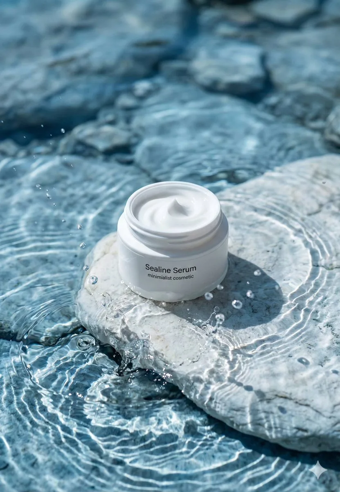

# Maercih — by @Maercihh

[← Back to Community Examples](../../EXAMPLES.md) · Category: Product & Brand · Model: `Nano Banana`

<a href="https://x.com/Maercihh/status/2018556431100993733"></a>

Source: **[@Maercihh on X](https://x.com/Maercihh/status/2018556431100993733)** · Creator: [Maercih](https://x.com/Maercihh)

## Prompt

```text
{
  "prompt": "A premium minimalist skincare product photography scene featuring an open white cosmetic jar labeled 'Sealine Serum'. The jar is placed on a smooth, pale stone partially submerged in crystal-clear shallow water. The cream inside the jar has a soft, glossy swirl with a pristine, silky texture. Gentle water ripples surround the stone, creating natural light refractions and caustic patterns on the surface below. Small water droplets and subtle splashes add freshness and motion. The environment feels serene, clean, and natural, evoking purity, hydration, and calm luxury. The color palette is cool and airy, dominated by soft whites, light blues, and stone neutrals. Lighting is bright, diffused daylight with soft highlights and minimal shadows, emphasizing texture, moisture, and realism. The composition is centered and balanced, with shallow depth of field and a softly blurred background for a high-end cosmetic advertising look. Ultra-realistic, photoreal, editorial-quality product shot.",
  "negative_prompt": "harsh shadows, dirty water, cluttered background, plastic texture, low resolution, oversharpening, unrealistic reflections, strong color cast, text artifacts, watermark, logo distortion, messy cream surface",
  "style": "luxury skincare advertising",
  "camera": {
    "type": "DSLR",
    "lens": "90mm macro",
    "aperture": "f/5.6",
    "iso": 100,
    "shutter_speed": "1/250"
  },
  "lighting": {
    "type": "natural diffused daylight",
    "direction": "top and side",
    "contrast": "low to medium",
    "temperature": "cool-neutral"
  },
  "composition": {
    "framing": "centered product focus",
    "angle": "slightly elevated",
    "orientation": "portrait",
    "depth_of_field": "shallow with soft background blur"
  },
  "quality": {
    "resolution": "8K",
    "detail": "ultra-fine texture detail",
    "sharpness": "high",
    "realism": "photorealistic"
  }
}
```

## Try it

Paste the prompt into **[vinano.ai](https://vinano.ai?utm_source=github&utm_medium=readme&utm_campaign=awesome-image-video-prompts-updating&utm_content=x-page-try)** to generate your own version.

> The image and prompt belong to @Maercihh ([original post](https://x.com/Maercihh/status/2018556431100993733)) and are shown here with credit for reference. Creators can ask for changes or removal by opening an issue.
