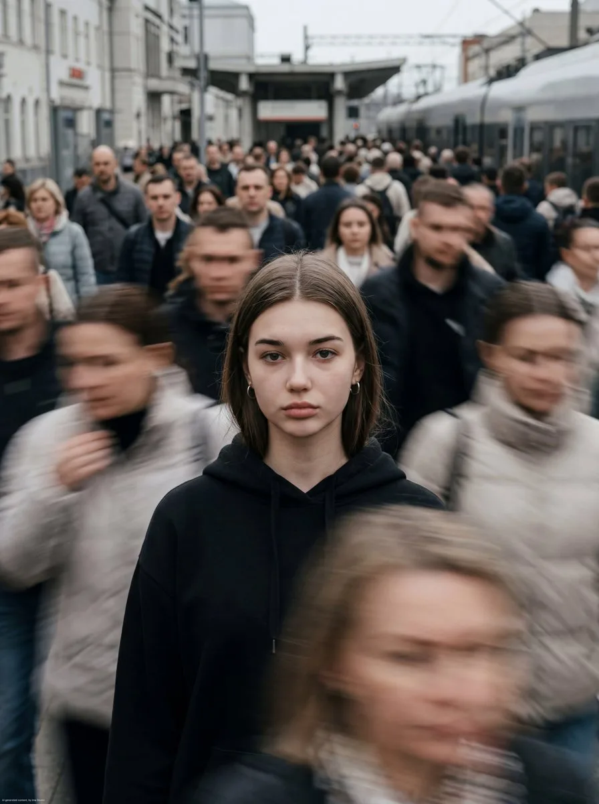

# 𝗦𝗮𝗻𝗶𝗮 — by @saniaspeaks_

[← Back to Community Examples](../../EXAMPLES.md) · Category: Photography · Model: `Nano Banana`

<a href="https://x.com/saniaspeaks_/status/2040991383008199123"></a>

Source: **[@saniaspeaks_ on X](https://x.com/saniaspeaks_/status/2040991383008199123)** · Creator: [𝗦𝗮𝗻𝗶𝗮](https://x.com/saniaspeaks_)

## Prompt

```text
Cinematic motion-blur photography shot on a Leica SL3 with a 50mm Summilux at f/2.8, captured from a chest-level frontal angle using slow shutter panning. 

Lighting setup: flat overcast daylight acting as soft diffusion, allowing long blur trails without harsh contrast. 

Color tone: muted concrete greys and pale skin neutrals inspired by A24 films. 

Subject: a Gen-Z female model standing completely still, sharp eyes, symmetrical face, real skin pores visible, wearing understated fashion. 

Crowd action: hundreds of commuters rushing past in all directions, bodies stretched into smooth horizontal and diagonal blur. 

Emotion: quiet rebellion through stillness. 

Aesthetic: editorial calm vs chaos. 

Post: clean motion physics, fine grain, no glitches, no face distortion, no warped anatomy.
```

## Try it

Paste the prompt into **[vinano.ai](https://vinano.ai?utm_source=github&utm_medium=readme&utm_campaign=awesome-image-video-prompts-updating&utm_content=x-page-try)** to generate your own version.

> The image and prompt belong to @saniaspeaks_ ([original post](https://x.com/saniaspeaks_/status/2040991383008199123)) and are shown here with credit for reference. Creators can ask for changes or removal by opening an issue.
