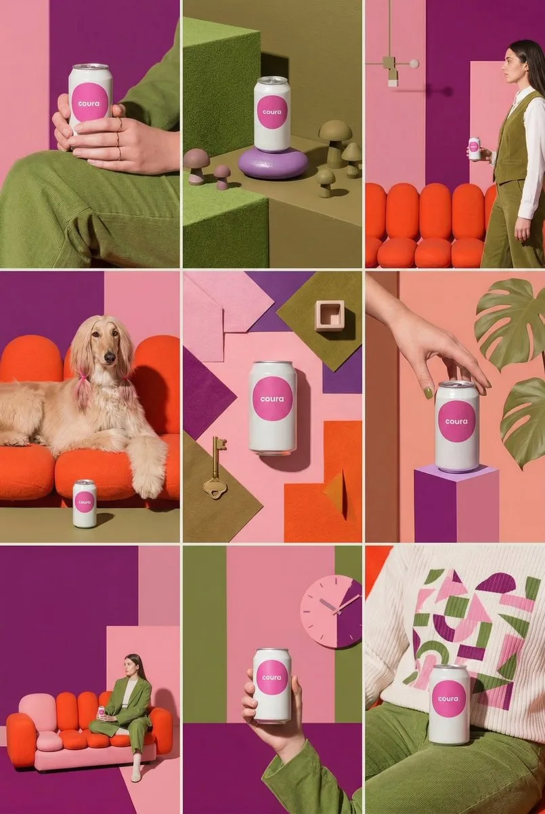

# Gizem Akdag — by @gizakdag

[← Back to Examples from X](../../EXAMPLES.md) · Category: Product & Brand · Model: `Nano Banana`

<a href="https://x.com/gizakdag/status/2027122256426521040"></a>

Original post: **[@gizakdag on X](https://x.com/gizakdag/status/2027122256426521040)** · Creator: [Gizem Akdag](https://x.com/gizakdag)

## Prompt

```text
Create a 9-image Instagram feed for this product in [the same aesthetic]. Use different locations, angles, and compositions, incorporating people, animals, nature, and various environments while maintaining a cohesive visual style.

with/without "same aesthetic"
```

## Try it

Paste the prompt into **[vinano.ai](https://vinano.ai?utm_source=github&utm_medium=readme&utm_campaign=awesome-image-video-prompts-updating&utm_content=x-page-try)** to generate your own version.

> The image and prompt belong to [@gizakdag](https://x.com/gizakdag) and are shown here with credit for reference. Creators can ask for changes or removal by opening an issue.
