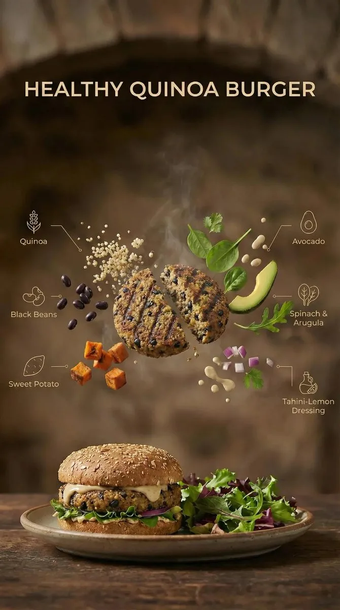

# Sharon Riley — by @Just_sharon7

[← Back to Examples from X](../../EXAMPLES.md) · Category: Food & Drink · Model: `Nano Banana`

<a href="https://x.com/Just_sharon7/status/2016340217146507313"></a>

Original post: **[@Just_sharon7 on X](https://x.com/Just_sharon7/status/2016340217146507313)** · Creator: [Sharon Riley](https://x.com/Just_sharon7)

## Prompt

```text
{
"presentation": "Deconstructed exploded view floating in mid-air above a finished burger on a plate",
    "burger_paddy": "Grilled quinoa and black bean patty with visible char marks, split in half with steam rising",
    "floating_ingredients": [
      "Grains of cooked quinoa",
      "Whole black beans",
      "Roasted sweet potato cubes",
      "Fresh spinach and arugula leaves",
      "Slices of ripe avocado",
      "Drips of creamy tahini-lemon dressing",
      "Diced red onion"
    ],
    "plated_item": "A complete burger on a seeded whole-grain bun with fresh greens and dressing, served on a ceramic plate with a side salad"
  },
  "style": {
    "aesthetic": "Professional commercial food photography",
    "lighting": "Warm, cinematic, moody lighting with soft highlights on the textures of the food",
    "background": "Dark, rustic, textured stone or clay oven-like background with a shallow depth of field (bokeh)",
    "color_palette": "Earthy tones, deep browns, vibrant greens, and warm oranges"
  },
  "composition": {
    "angle": "Eye-level, straight-on shot",
    "dynamic_elements": "Floating gravity-defying arrangement, wisps of steam, droplets of sauce",
    "text_overlay_optional": "Clean gold serif typography at the top reading 'HEALTHY QUINOA BURGER'"
  },
  "technical_specs": {
    "focus": "Sharp focus on the floating patty and ingredients",
    "lens": "Macro lens for high detail texture on grains and vegetables",
    "quality": "8k resolution, photorealistic, commercial advertising quality"
  }
}
```

## Try it

Paste the prompt into **[vinano.ai](https://vinano.ai?utm_source=github&utm_medium=readme&utm_campaign=awesome-image-video-prompts-updating&utm_content=x-page-try)** to generate your own version.

> The image and prompt belong to [@Just_sharon7](https://x.com/Just_sharon7) and are shown here with credit for reference. Creators can ask for changes or removal by opening an issue.
