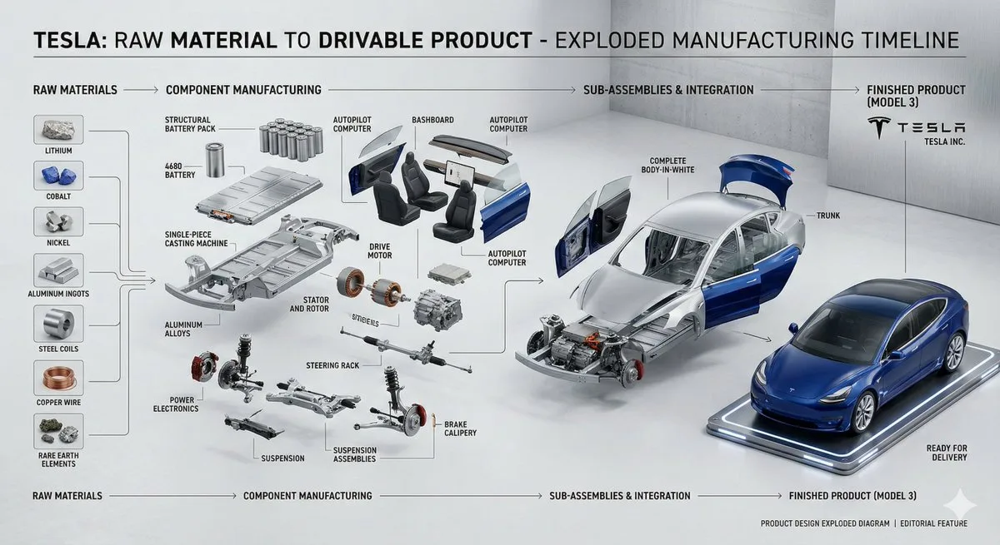

# 两斤 — by @0x00_Krypt

[← Back to Examples from X](../../EXAMPLES.md) · Category: UI & Graphic · Model: `Nano Banana`

<a href="https://x.com/0x00_Krypt/status/2028376944996470842"></a>

Original post: **[@0x00_Krypt on X](https://x.com/0x00_Krypt/status/2028376944996470842)** · Creator: [两斤](https://x.com/0x00_Krypt)

## Prompt

```text
product design, [object], cross-section cutaway view, internal anatomy revealed, 
white background, museum specimen aesthetic, scientific illustration style
```

## Try it

Paste the prompt into **[vinano.ai](https://vinano.ai?utm_source=github&utm_medium=readme&utm_campaign=awesome-image-video-prompts-updating&utm_content=x-page-try)** to generate your own version.

> The image and prompt belong to [@0x00_Krypt](https://x.com/0x00_Krypt) and are shown here with credit for reference. Creators can ask for changes or removal by opening an issue.
