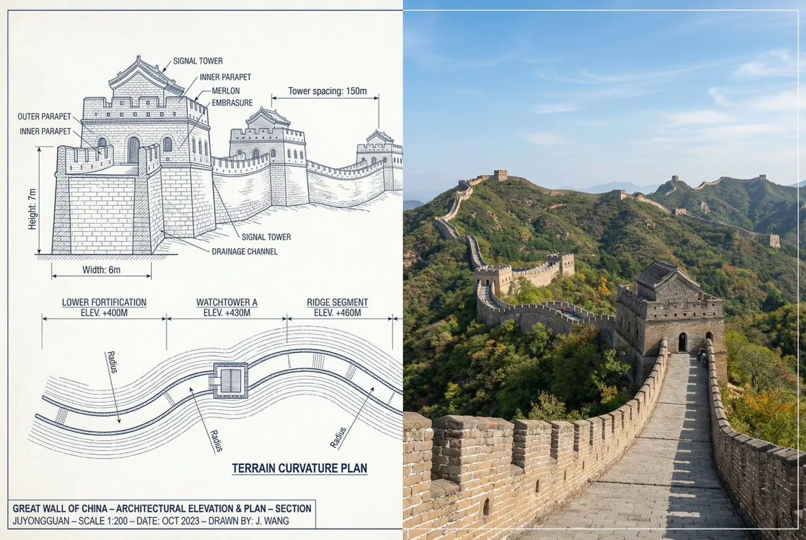

# 𝐌 — by @Strength04_X

[← Back to Examples from X](../../EXAMPLES.md) · Category: Photography · Model: `Nano Banana`

<a href="https://x.com/Strength04_X/status/2020051579710374133"></a>

Original post: **[@Strength04_X on X](https://x.com/Strength04_X/status/2020051579710374133)** · Creator: [𝐌](https://x.com/Strength04_X)

## Prompt

```text
{
  "objective": "Create a side-by-side comparison image featuring a technical sketch and real photograph of the Great Wall of China",
  "image_specifications": {
    "style": "Mixed media (Technical drawing + Real photograph)",
    "layout": "Horizontal split - Left side: Sketch with measurements, Right side: Real photo",
    "aspect_ratio": "3:2"
  },
  "left_side": {
    "content_type": "Technical sketch of the Great Wall of China",
    "features": [
      "Detailed architectural lines showing wall segments, watchtowers, and defensive structures",
      "Numerical measurements for wall height, width, and tower spacing",
      "Elevation labels for wall sections and towers",
      "Side elevation and top-down layout illustrating wall curvature along terrain"
    ],
    "text_annotations": {
      "units": "Metric (meters)",
      "language": "English",
      "font_style": "Blueprint or engineering-style typography"
    },
    "positioning": "Take up the left half of the image"
  },
  "right_side": {
    "content_type": "High-resolution real photo of the Great Wall of China",
    "features": [
      "Wide panoramic view of the wall stretching across mountains",
      "Natural daylight with clear or lightly clouded sky",
      "Realistic colors with visible stone texture and surrounding landscape"
    ],
    "positioning": "Take up the right half of the image"
  },
  "visual_elements": {
    "border_division": "Vertical line or subtle transition between left (sketch) and right (photo)",
    "color_palette": {
      "left": "Monochrome or blueprint blue for sketch",
      "right": "Natural realistic colors"
    }
  },
  "output_format": {
    "type": "Image",
    "use_case": [
      "Educational poster",
      "Architectural comparison",
      "Historical visualization",
      "Tourism visual aid"
    ],
    "high_resolution": true
  }
}
```

## Try it

Paste the prompt into **[vinano.ai](https://vinano.ai?utm_source=github&utm_medium=readme&utm_campaign=awesome-image-video-prompts-updating&utm_content=x-page-try)** to generate your own version.

> The image and prompt belong to [@Strength04_X](https://x.com/Strength04_X) and are shown here with credit for reference. Creators can ask for changes or removal by opening an issue.
