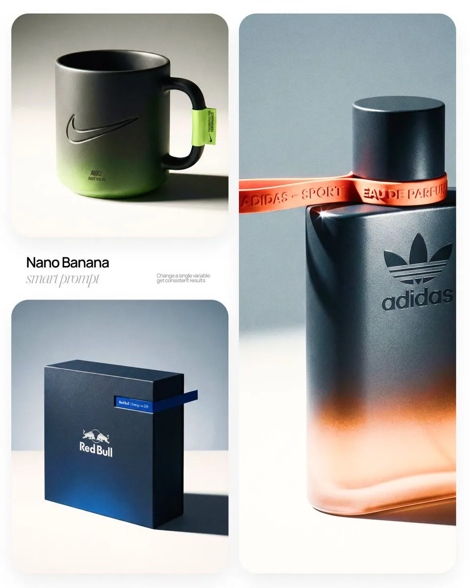

# AmirMušić — by @AmirMushich

[← Back to Community Examples](../../EXAMPLES.md) · Category: Product & Brand · Model: `Nano Banana`

<a href="https://x.com/AmirMushich/status/2046265195434070061"></a>

Source: **[@AmirMushich on X](https://x.com/AmirMushich/status/2046265195434070061)** · Creator: [AmirMušić](https://x.com/AmirMushich)

## Prompt

```text
[BRAND NAME] | [OBJECT]

Act as a High-End Commercial Product Photographer and Creative Director shooting a luxury editorial campaign (Hypebeast / Highsnobiety /Wallpaper* level).

PHASE 1: BRAND INTELLIGENCE
The hero subject is a [OBJECT] branded for [BRAND NAME]. Autonomously determine [BRAND NAME]'s full visual identity: signature color palette, typographic DNA, logo mark geometry, material language, and cultural positioning. Apply this identity to the [OBJECT] with precision — do not invent a generic brand, decode the real visual codes.

PHASE 2: OBJECT SURFACE & MATERIAL DNA
Regardless of the shape of [OBJECT], apply this material system: Base tone: deep neutral — matte dark graphite, warm charcoal, or matte black. Fine-grain surface micro-texture visible under raking light — powder-coat, matte paper, or brushed material feel. Subtle gradient bloom: the base color dissolves in the lower portion of the object's surface into the brand's most iconic accent color — a soft luminous haze from within the material, not a printed graphic. Logo application: embossed, debossed, or metallic foil relief — catching specular light at edges only. Precise. Restrained. Typography: brand-accurate typeface, small tracking, positioned  with editorial intentionality.

PHASE 3: THE ACCENT BREAKOUT ELEMENT
This is the signature design move — adapt it to the natural geometry of [OBJECT]: Identify the most logical "interruption zone" on [OBJECT] — a seam, edge, band, collar, rim, strap, or wrap point. At this zone, apply a narrow saturated accent element in the brand's most iconic hue — vivid, slightly matte. This element must visually "break out" of the object's boundary — extending, protruding, or wrapping beyond the expected edge, creating a deliberate 3D tension between the object and the detail.The accent element carries a micro-typographic brand detail — tagline, model name, or descriptor — small, precise, tracked.

PHASE 4: STAGING & COMPOSITION
Studio cyclorama. Surface tone: off-white to warm light gray. Background field: cool neutral mid-gray, darker in upper zone. [OBJECT] positioned at 3/4 angle — front face and one secondary surface simultaneously visible. Rule of thirds: object occupies right 60% of frame. Left field: generous negative space — intentional, not empty. Single hard-edged directional shadow cast to the right and slightly downward — crisp penumbra, no diffusion.

PHASE 5: LIGHTING
Single dominant key light: large softbox, camera-left, elevated at 40°. Specular highlight traces the top-left edge of [OBJECT] — revealing material grain. Shadow side: no fill. Darkness earns depth. Subtle ambient bounce from cyclorama floor — lifts shadow by 15%, no more. Accent element receives micro-specular glint along its dominant edge. Mood: Rembrandt chiaroscuro logic applied to product photography. No lens flare. No atmospheric effects.

PHASE 6: TECH SPECS
Lens: 85mm equivalent, f/4.5. Depth of field: object fully sharp, background softened. Chromatic aberration: subtle, at extreme frame edges only — optical realism signal. Film grain overlay: 15% opacity — anti-CGI-plastic treatment. Render: Octane / Ray Tracing quality —subsurface scattering where material demands it, global illumination, physically accurate shadow falloff. Aspect ratio: autonomously determine optimal ratio for this [OBJECT] format.
```

## Try it

Paste the prompt into **[vinano.ai](https://vinano.ai?utm_source=github&utm_medium=readme&utm_campaign=awesome-image-video-prompts-updating&utm_content=x-page-try)** to generate your own version.

> The image and prompt belong to @AmirMushich ([original post](https://x.com/AmirMushich/status/2046265195434070061)) and are shown here with credit for reference. Creators can ask for changes or removal by opening an issue.
