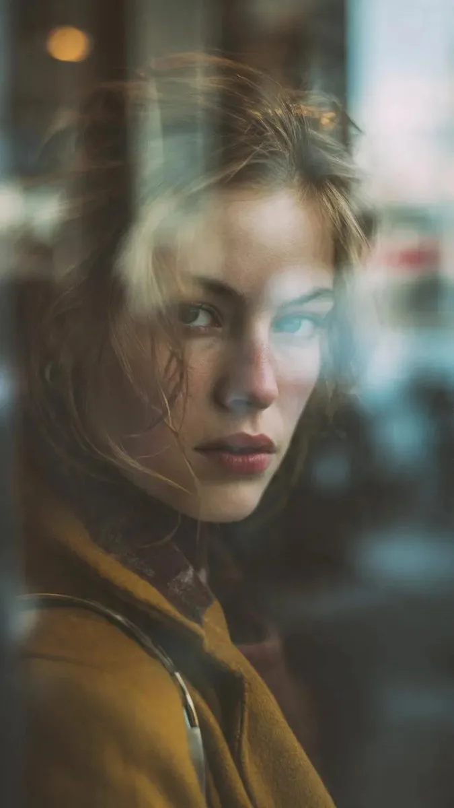

# K — by @ChillaiKalan__

[← Back to Community Examples](../../EXAMPLES.md) · Category: Photography · Model: `Nano Banana`

<a href="https://x.com/ChillaiKalan__/status/2026846972351852719"></a>

Source: **[@ChillaiKalan__ on X](https://x.com/ChillaiKalan__/status/2026846972351852719)** · Creator: [K](https://x.com/ChillaiKalan__)

## Prompt

```text
Reflection in glass window, layered composition, subject of a beautiful woman partially obscured. Fujifilm GFX100S, 80mm f/1.7 Natural diffused light Muted Portra LUT Aspect 3:4 harmony: 60% realism / 40% artistic. sRef: layered documentary imagery. Hidden tokens: glass reflection blur, layered city depth."
```

## Try it

Paste the prompt into **[vinano.ai](https://vinano.ai?utm_source=github&utm_medium=readme&utm_campaign=awesome-image-video-prompts-updating&utm_content=x-page-try)** to generate your own version.

> The image and prompt belong to @ChillaiKalan__ ([original post](https://x.com/ChillaiKalan__/status/2026846972351852719)) and are shown here with credit for reference. Creators can ask for changes or removal by opening an issue.
