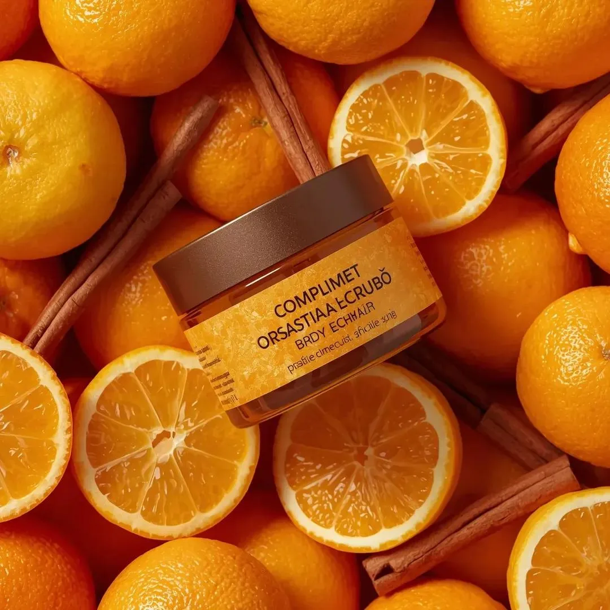

# Oogie — by @oggii_0

[← Back to Examples from X](../../EXAMPLES.md) · Category: Product & Brand · Model: `Nano Banana`

<a href="https://x.com/oggii_0/status/2029116168800485686"></a>

Original post: **[@oggii_0 on X](https://x.com/oggii_0/status/2029116168800485686)** · Creator: [Oogie](https://x.com/oggii_0)

## Prompt

```text
Use the uploaded image as the exact visual reference for composition, jar design, orange slices, whole oranges, cinnamon sticks, lighting, and orange background. Maintain the same top-down perspective and color palette.

Camera:
Top-down camera angle (exactly as in the image).
Camera slowly zooms in toward the jar.
Very smooth and controlled movement.
No rotation.
No camera shake.

Action:

The jar remains perfectly still in the center of the frame.
```

## Try it

Paste the prompt into **[vinano.ai](https://vinano.ai?utm_source=github&utm_medium=readme&utm_campaign=awesome-image-video-prompts-updating&utm_content=x-page-try)** to generate your own version.

> The image and prompt belong to [@oggii_0](https://x.com/oggii_0) and are shown here with credit for reference. Creators can ask for changes or removal by opening an issue.
