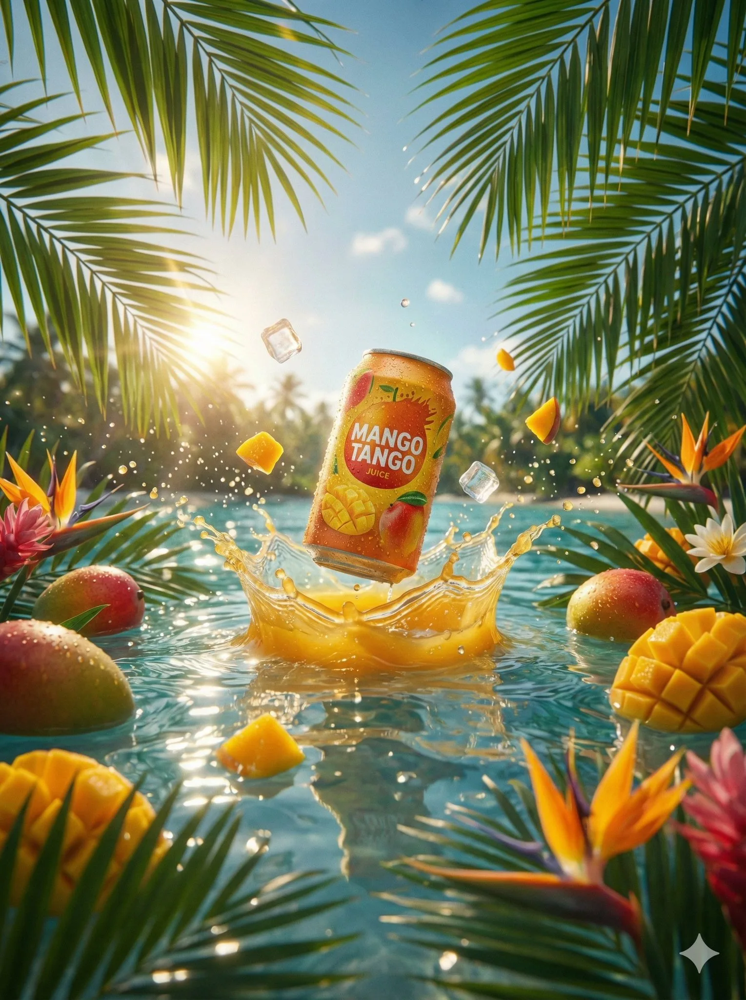

# 𝐌 — by @Strength04_X

[← Back to Community Examples](../../EXAMPLES.md) · Category: Product & Brand · Model: `Nano Banana`

<a href="https://x.com/Strength04_X/status/2010290781819695350"></a>

Source: **[@Strength04_X on X](https://x.com/Strength04_X/status/2010290781819695350)** · Creator: [𝐌](https://x.com/Strength04_X)

## Prompt

```text
A hyper-realistic commercial product photography shot of a condensation-covered beverage can labeled "MANGO TANGO JUICE" bursting dynamically out of crystal clear turquoise ocean water. The can is surrounded by a splash of golden mango juice and water. Levitating around the can are fresh whole mangoes, diced mango cubes, and crystal clear ice cubes. The foreground includes vibrant tropical flowers and green palm leaves framing the shot. The background features a blurred sunny tropical beach with palm trees. Bright cinematic backlighting with a sun flare, sparkling water reflections, high contrast, 8k resolution, vibrant colors.
```

## Try it

Paste the prompt into **[vinano.ai](https://vinano.ai?utm_source=github&utm_medium=readme&utm_campaign=awesome-image-video-prompts-updating&utm_content=x-page-try)** to generate your own version.

> The image and prompt belong to @Strength04_X ([original post](https://x.com/Strength04_X/status/2010290781819695350)) and are shown here with credit for reference. Creators can ask for changes or removal by opening an issue.
