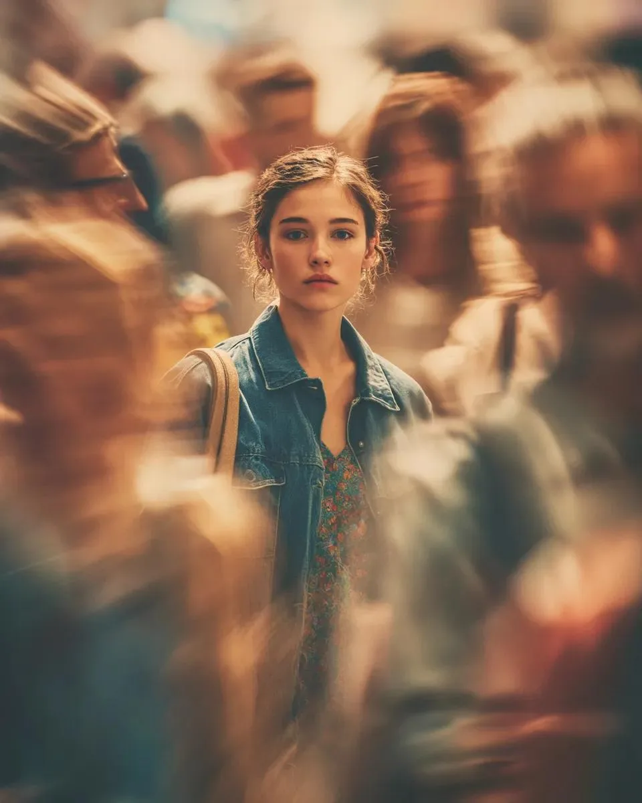

# Taaruk — by @Taaruk_

[← Back to Examples from X](../../EXAMPLES.md) · Category: Photography · Model: `Nano Banana`

<a href="https://x.com/Taaruk_/status/2021859477130293356"></a>

Original post: **[@Taaruk_ on X](https://x.com/Taaruk_/status/2021859477130293356)** · Creator: [Taaruk](https://x.com/Taaruk_)

## Prompt

```text
Cinematic portrait of a young person standing still in the middle of a busy crowd, sharp focus on the subject while people move rapidly around them creating strong motion blur. The subject looks directly at the camera with a calm, introspective expression. Soft natural lighting, shallow depth of field, dreamy atmosphere. Crowd blurred using long exposure effect, dynamic movement streaks surrounding the subject. Neutral pastel background tones, subtle color grading, emotional storytelling composition. Shot on 85mm lens, f/1.8, long shutter speed, ultra-realistic skin texture, cinematic photography, 8K resolution.
```

## Try it

Paste the prompt into **[vinano.ai](https://vinano.ai?utm_source=github&utm_medium=readme&utm_campaign=awesome-image-video-prompts-updating&utm_content=x-page-try)** to generate your own version.

> The image and prompt belong to [@Taaruk_](https://x.com/Taaruk_) and are shown here with credit for reference. Creators can ask for changes or removal by opening an issue.
