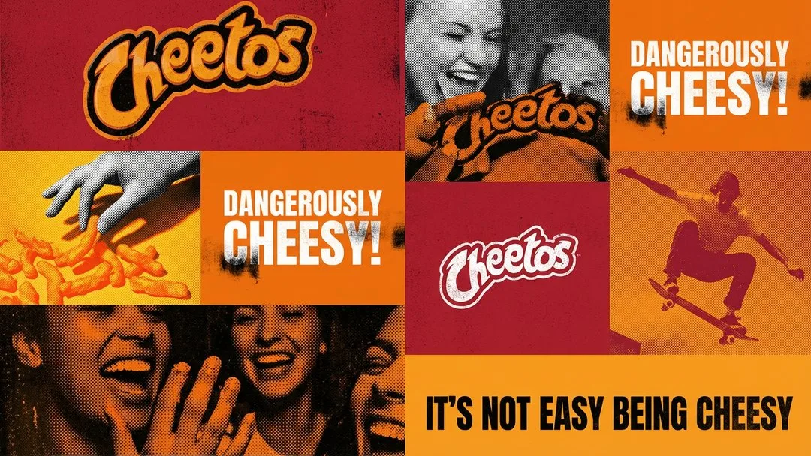

# AI Pulse — by @youraipulse

[← Back to Examples from X](../../EXAMPLES.md) · Category: Product & Brand · Model: `Nano Banana`

<a href="https://x.com/youraipulse/status/2011094013101695427"></a>

Original post: **[@youraipulse on X](https://x.com/youraipulse/status/2011094013101695427)** · Creator: [AI Pulse](https://x.com/youraipulse)

## Prompt

```text
[BRAND NAME]. 
Act as a graphic design creative director constructing a highly structured "Campaign Visual Identity Grid."

COMPOSITION (SPECIFIC 2-COLUMN ASYMMETRICAL LAYOUT):

The image must follow a strict 2-column grid structure, exactly like the layout seen in professional campaign boards.

LAYOUT STRUCTURE (TOP TO BOTTOM):
ROW 1: One single, full-width rectangular block (e.g., a wide photo).
ROW 2: Two equal-sized square blocks side-by-side.
ROW 3: One single, full-width rectangular block
ROW 4: Two equal-sized square blocks side-by-side.
ROW 5: One single, full-width rectangular block at the bottom.
The grid must be perfectly stable, with all blocks forming this exact pattern.

CRITICAL CONSTRAINTS:
FULL BLEED (100% COVERAGE): The grid must occupy the ENTIRE canvas area from edge to edge. There are absolutely NO margins, NO borders, and NO background space visible.

ZERO SPACING (NO GAPS): The grid tiles must be seamlessly abutted. There should be absolutely NO gutters, white lines, or spacing between the blocks. They must touch perfectly to form a solid wall.

GLOBAL RULES:
Typography: Use ONLY ONE font.
Uniqueness: Every photo cell must be UNIQUE. No duplicates.

THE GRID CONTENT & SPECIFIC TEXTURES (3 TYPES):
Distribute these three block types rhythmically throughout the specific 2-column layout defined above:

TYPE A: THE LOGO BLOCK (PRINT GRUNGE):
A solid block in the brand's primary color containing ONLY the official [BRAND NAME] logomark centered.
Texture: Distressed screen-print texture with slight ink bleed and grunge noise.

TYPE B: THE SLOGAN BLOCK (PRINT GRUNGE):

A solid block in a contrasting brand color containing ONLY the official [BRAND NAME] slogan.
Texture: Heavy distressed ink texture and grunge print effects on typography and fill.

TYPE C: CAMPAIGN PHOTOGRAPHY (HALFTONE):
High-contrast B&W action shots or portraits relevant to the brand.

Texture: Apply strong halftone dot patterns (raster dots) and heavy film grain. Use "Multiply" color blending to wash the photos in the brand's specific color palette (duotone effect).
```

## Try it

Paste the prompt into **[vinano.ai](https://vinano.ai?utm_source=github&utm_medium=readme&utm_campaign=awesome-image-video-prompts-updating&utm_content=x-page-try)** to generate your own version.

> The image and prompt belong to [@youraipulse](https://x.com/youraipulse) and are shown here with credit for reference. Creators can ask for changes or removal by opening an issue.
