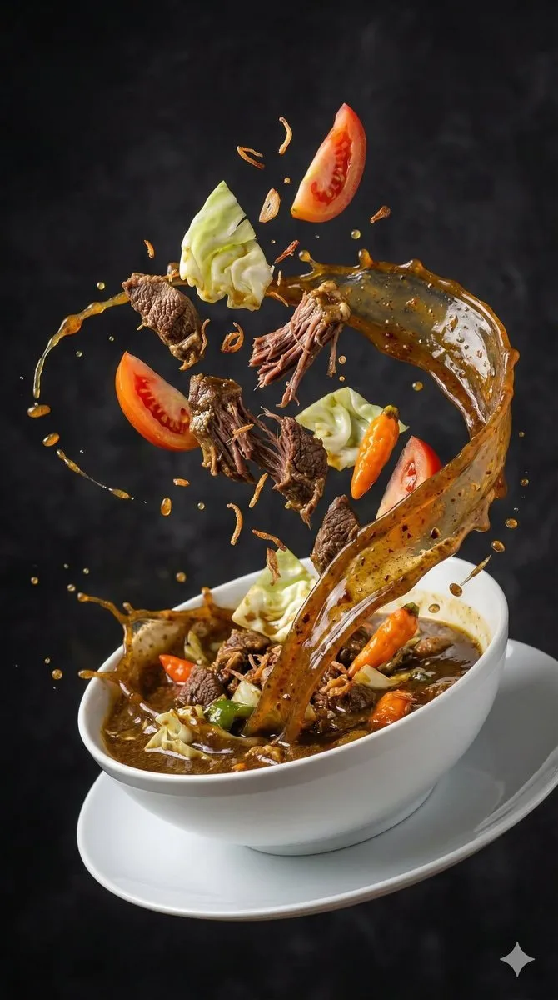

# Taaruk — by @Taaruk_

[← Back to Examples from X](../../EXAMPLES.md) · Category: Food & Drink · Model: `Nano Banana`

<a href="https://x.com/Taaruk_/status/2022540091244036192"></a>

Original post: **[@Taaruk_ on X](https://x.com/Taaruk_/status/2022540091244036192)** · Creator: [Taaruk](https://x.com/Taaruk_)

## Prompt

```text
{
  "image_prompt": {
    "subject": "Rich Asian soup",
    "action": "Ingredients exploding upward in mid-air, swirling spiral splash of broth forming a dynamic ribbon shape, liquid splash crown",
    "ingredients": [
      "Floating beef slices",
      "Shrimp",
      "Noodles",
      "Tofu cubes",
      "Chili",
      "Herbs",
      "Tomatoes",
      "Cabbage"
    ],
    "environment": "Dramatic dark textured background",
    "lighting": "Studio lighting, strong rim light, glossy broth reflections, cinematic contrast",
    "photography_style": "Ultra-realistic food photography, high-speed photography, frozen motion, hyper realistic",
    "camera_settings": {
      "lens": "85mm",
      "aperture": "f/4",
      "focus": "Sharp focus, macro clarity",
      "resolution": "8K"
    }
  }
}
```

## Try it

Paste the prompt into **[vinano.ai](https://vinano.ai?utm_source=github&utm_medium=readme&utm_campaign=awesome-image-video-prompts-updating&utm_content=x-page-try)** to generate your own version.

> The image and prompt belong to [@Taaruk_](https://x.com/Taaruk_) and are shown here with credit for reference. Creators can ask for changes or removal by opening an issue.
