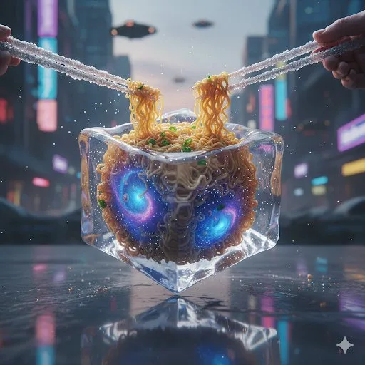

# Cuties — by @cuties7377

[← Back to Examples from X](../../EXAMPLES.md) · Category: Food & Drink · Model: `Nano Banana`

<a href="https://x.com/cuties7377/status/2011444163863048380"></a>

Original post: **[@cuties7377 on X](https://x.com/cuties7377/status/2011444163863048380)** · Creator: [Cuties](https://x.com/cuties7377)

## Prompt

```text
{
  "content_goal": "viral food visual with high appetite appeal",
  "image_type": "ultra-photorealistic food photography",
  "visual_style": {
    "aesthetic": "cinematic food editorial, premium street-food style",
    "vibe": "steamy, savory, irresistible",
    "realism": "high-end commercial food realism"
  },
  "composition": {
    "framing": "close-up or medium close-up",
    "camera_angle": "45-degree or slightly top-front angle",
    "subject_position": "centered hero bowl or lifted noodles",
    "perspective": "depth-rich with strong foreground emphasis"
  },
  "subject": {
    "description": "freshly prepared noodles captured at peak texture",
    "presentation": "chopsticks or fork lifting noodles mid-air",
    "details": "long glossy strands with visible sauce coating",
    "ingredients": "vegetables, protein, herbs, sesame seeds"
  },
  "texture_details": {
    "noodles": "silky, elastic strands with sauce cling",
    "sauce": "rich, glossy, evenly coated",
    "steam": "visible rising steam for freshness",
    "garnish": "spring onions, chili flakes, sesame"
  },
  "styling": {
    "bowl": "ceramic or rustic bowl",
    "props": "chopsticks, linen napkin, subtle tableware",
    "messiness": "controlled, appetizing chaos"
  },
  "lighting": {
    "type": "warm directional food lighting",
    "quality": "soft yet contrast-rich",
    "direction": "side or top-side light",
    "highlight_focus": "noodle gloss and steam",
    "shadow_style": "soft shadows for depth"
  },
  "color_palette": {
    "primary": ["golden brown", "soy sauce tones", "warm amber"],
    "accent": ["chili red", "herb green"],
    "mood": "cozy, savory, indulgent"
  },
  "environment": {
    "location": "street-food stall, modern kitchen, or studio setup",
    "background": "dark or softly blurred background",
    "atmosphere": "warm, comforting, flavorful"
  },
  "camera_details": {
    "camera_type": "professional DSLR or mirrorless simulation",
    "lens": "85mm or macro food lens",
    "focus": "tack-sharp on lifted noodles",
    "depth_of_field": "shallow background blur",
    "resolution": "advertising-grade clarity"
  },
  "quality_control": {
    "food_realism": "hyper-real texture without plastic look",
    "steam_accuracy": "natural steam physics",
    "ai_artifacts": "none",
    "professional_finish": "commercial food photography quality"
  },
  "overall_mood": "comforting, rich, mouth-watering",
  "intended_use": {
    "primary": "viral food post on X",
    "secondary": "restaurant branding, food editorial, ads"
  }
}
```

## Try it

Paste the prompt into **[vinano.ai](https://vinano.ai?utm_source=github&utm_medium=readme&utm_campaign=awesome-image-video-prompts-updating&utm_content=x-page-try)** to generate your own version.

> The image and prompt belong to [@cuties7377](https://x.com/cuties7377) and are shown here with credit for reference. Creators can ask for changes or removal by opening an issue.
