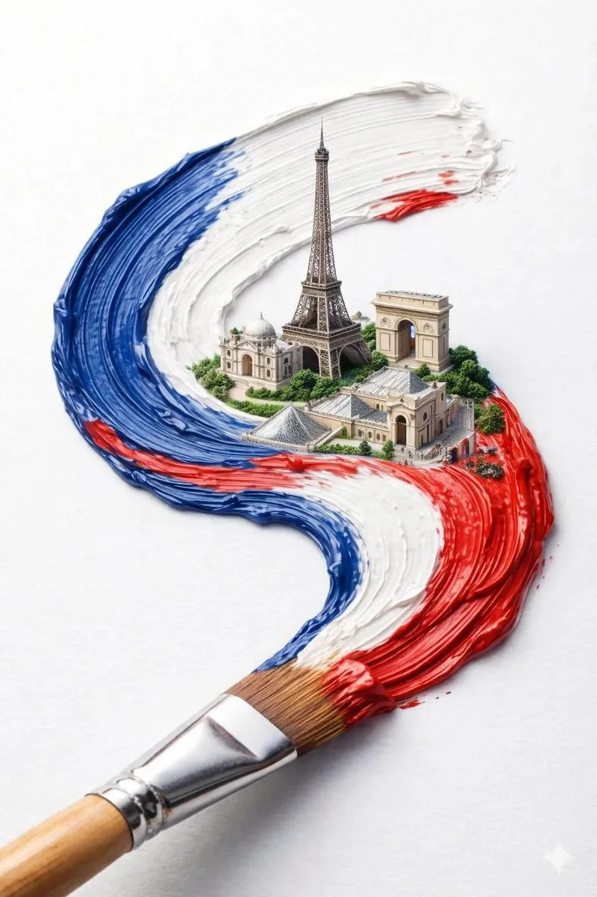

# simeon-sanai — by @Naiknelofar788

[← Back to Community Examples](../../EXAMPLES.md) · Category: Poster Design · Model: `Nano Banana`

<a href="https://x.com/Naiknelofar788/status/2042058511937679439"></a>

Source: **[@Naiknelofar788 on X](https://x.com/Naiknelofar788/status/2042058511937679439)** · Creator: [simeon-sanai](https://x.com/Naiknelofar788)

## Prompt

```text
A hyper-realistic macro shot of a paintbrush creating a thick textured paint stroke on a clean white background. The paint forms the shape and colors of the [COUNTRY FLAG], flowing dynamically like a wave. Inside the paint stroke, a highly detailed miniature cityscape of [COUNTRY NAME] emerges, including iconic landmarks such as [LANDMARK 1], [LANDMARK 2], [LANDMARK 3]. The paint has visible brush textures, glossy acrylic finish, rich vibrant colors.
```

## Try it

Paste the prompt into **[vinano.ai](https://vinano.ai?utm_source=github&utm_medium=readme&utm_campaign=awesome-image-video-prompts-updating&utm_content=x-page-try)** to generate your own version.

> The image and prompt belong to @Naiknelofar788 ([original post](https://x.com/Naiknelofar788/status/2042058511937679439)) and are shown here with credit for reference. Creators can ask for changes or removal by opening an issue.
