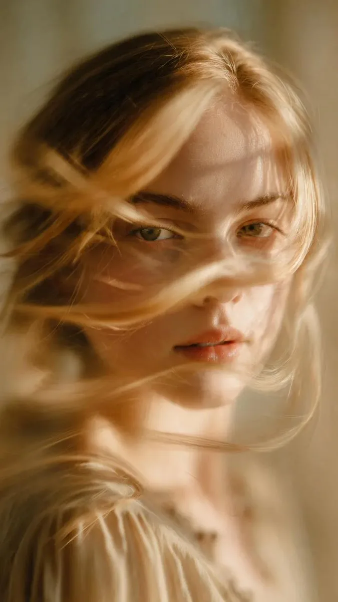

# K — by @ChillaiKalan__

[← Back to Community Examples](../../EXAMPLES.md) · Category: Photography · Model: `Nano Banana`

<a href="https://x.com/ChillaiKalan__/status/2022733333218955487"></a>

Source: **[@ChillaiKalan__ on X](https://x.com/ChillaiKalan__/status/2022733333218955487)** · Creator: [K](https://x.com/ChillaiKalan__)

## Prompt

```text
A soft-focus, cinematic portrait of a young woman with delicate facial features and light golden hair, caught in motion. Her face appears partially blurred and ghosted, with flowing strands of hair captured mid-sway, creating a dreamy, ethereal motion effect. Her expression is serene and slightly distant, with parted lips and eyes softly open. The entire frame is bathed in golden beige and sepia tones, evoking a nostalgic, painterly atmosphere. The lighting is natural and diffused, coming from a nearby window, casting a warm glow on her skin and illuminating the strands of hair that dance across the frame. Photographed with a Canon EOS R5 using an 85mm lens at f/1.2, ISO 320, shutter speed 1/8s with intentional slow exposure and handheld movement to create the artistic motion blur. The focus is soft, with a shallow depth of field that isolates the subject from the pale, creamy background. Post-processed in Adobe Lightroom and Photoshop: cinematic LUTs applied, warmth enhanced through split-toning (shadows in soft amber, highlights in cream), clarity reduced, and motion streaks refined with displacement layers and radial blur filters. A very subtle fine grain adds a filmic texture. Final mood: emotional, hazy, poetic. Style references: fine art portraiture, vintage editorial, and analog dream sequences. 4K ultra-resolution, no harsh contrasts, smooth gradients preserved.
```

## Try it

Paste the prompt into **[vinano.ai](https://vinano.ai?utm_source=github&utm_medium=readme&utm_campaign=awesome-image-video-prompts-updating&utm_content=x-page-try)** to generate your own version.

> The image and prompt belong to @ChillaiKalan__ ([original post](https://x.com/ChillaiKalan__/status/2022733333218955487)) and are shown here with credit for reference. Creators can ask for changes or removal by opening an issue.
