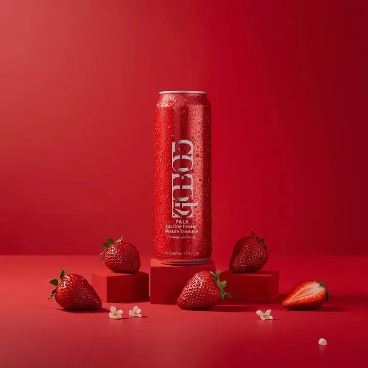

# 𝐌 — by @Strength04_X

[← Back to Community Examples](../../EXAMPLES.md) · Category: Product & Brand · Model: `Nano Banana`

<a href="https://x.com/Strength04_X/status/2017622879190573425"></a>

Source: **[@Strength04_X on X](https://x.com/Strength04_X/status/2017622879190573425)** · Creator: [𝐌](https://x.com/Strength04_X)

## Prompt

```text
A premium studio product photograph of a tall, slim red aluminum sparkling water can standing upright and centered against a seamless vivid red background, the can covered in fine condensation droplets with crisp white typography reading “GOOD IDEA” and smaller flavor text beneath, positioned on a matte red surface with subtle reflections, surrounded symmetrically by fresh ripe strawberries with glossy seeds and deep red flesh, some resting directly on the surface and others placed on small red rectangular blocks to the left and right, delicate white elderflower blossoms scattered between the fruit for contrast, the lighting soft yet directional from the upper left creating gentle highlights on the can's metallic texture and soft shadows beneath the fruit, the color palette dominated by saturated reds with clean white accents and natural green stems, the composition minimal and perfectly balanced with generous negative space above the product, shallow depth of field, ultra-sharp focus on the can, high-end commercial aesthetic, photorealistic, studio-grade, cinematic realism.
```

## Try it

Paste the prompt into **[vinano.ai](https://vinano.ai?utm_source=github&utm_medium=readme&utm_campaign=awesome-image-video-prompts-updating&utm_content=x-page-try)** to generate your own version.

> The image and prompt belong to @Strength04_X ([original post](https://x.com/Strength04_X/status/2017622879190573425)) and are shown here with credit for reference. Creators can ask for changes or removal by opening an issue.
