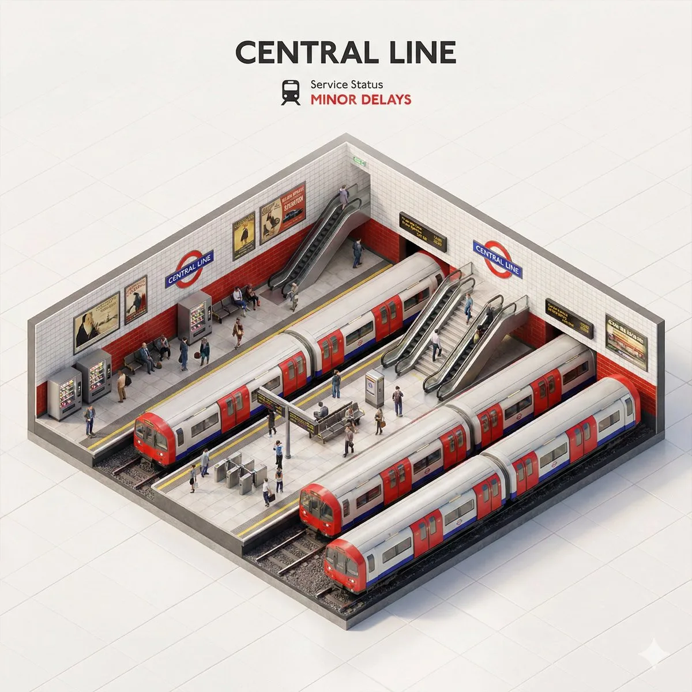

# Milo — by @Milo_Bahi_02

[← Back to Examples from X](../../EXAMPLES.md) · Category: Illustration & 3D · Model: `Nano Banana`

<a href="https://x.com/Milo_Bahi_02/status/2011751906318958830"></a>

Original post: **[@Milo_Bahi_02 on X](https://x.com/Milo_Bahi_02/status/2011751906318958830)** · Creator: [Milo](https://x.com/Milo_Bahi_02)

## Prompt

```text
8K Ultra-Realistic Promotional
Present a clear, 45° top-down isometric miniature 3D scene of the [SUBWAY SYSTEM / LINE NAME]. The scene includes stylized diorama elements such as platforms, miniature trains, stairwells, signage, tiled walls, vending machines, and people waiting.
Use soft, refined textures, realistic PBR materials, and lifelike lighting with subtle shadows to enhance dimensional clarity.
At the top center, place the title “[LINE NAME]” in bold sans-serif text. Below it, add a train icon followed by “Service Status” (small text) and “[STATUS MESSAGE]”  red medium text for delays or green for on-time service.
Use a soft, solid tile white background for clarity. Clean, centered, editorial infographic style.
Square format 1080×1080, ultra-detailed 3D render, miniature realism, 8K look, image size 1: 1
```

## Try it

Paste the prompt into **[vinano.ai](https://vinano.ai?utm_source=github&utm_medium=readme&utm_campaign=awesome-image-video-prompts-updating&utm_content=x-page-try)** to generate your own version.

> The image and prompt belong to [@Milo_Bahi_02](https://x.com/Milo_Bahi_02) and are shown here with credit for reference. Creators can ask for changes or removal by opening an issue.
