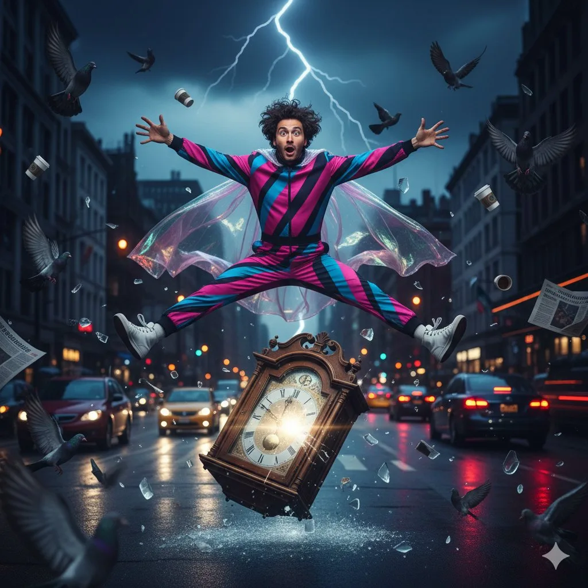

# Cuties — by @cuties7377

[← Back to Community Examples](../../EXAMPLES.md) · Category: Photography · Model: `Nano Banana`

<a href="https://x.com/cuties7377/status/2010225997463834883"></a>

Source: **[@cuties7377 on X](https://x.com/cuties7377/status/2010225997463834883)** · Creator: [Cuties](https://x.com/cuties7377)

## Prompt

```text
{
  "content_goal": 
"viral athletic jump freeze post",
  "image_type":
 "jump freeze action photography",
  "visual_style": 
"cinematic sports editorial, high-impact, premium",
  "motion_concept": {
    "action_type":
 "jump freeze",
    "timing": 
"captured at peak height",
    "motion_state": 
"completely frozen mid-air",
    "energy":
 "explosive yet controlled"
  },
  "pose_details": {
    "pose_name":
 "jump freeze flex pose",
    "body_position": 
"mid-air jump with legs extended or flexed symmetrically",
    "core_engagement":
 "tight core with visible strength",
    "arm_position": 
"balanced, expressive, athletic alignment",
    "freeze_quality": 
"sharp, suspended, gravity-defying"
  },
  "subject": {
    "description":
 "athletic feminine body performing a powerful jump freeze",
    "physique": "lean, flexible, toned",
    "body_language": "confident, fearless, strong",
    "expression": "focused intensity with calm control"
  },
  "facial_details": {
    "emotion": "determination mixed with ease",
    "micro_details": "relaxed face, steady eyes, natural expression"
  },
  "wardrobe": {
    "clothing": "professional athletic performance wear",
    "fit": "body-contoured to emphasize motion lines",
    "fabric": "stretch performance fabric, non-reflective",
    "color_tones": "solid neutral or bold single color"
  },
  "environment": {
    "location": "minimal studio or clean gym space",
    "background": "plain or gradient backdrop",
    "atmosphere": "focused, powerful, distraction-free"
  },
  "lighting": {
    "type": "high-speed studio lighting",
    "quality": "crisp, clean, cinematic",
    "direction": "side and top lighting",
    "effect": "freeze motion sharply with defined muscle highlights"
  },
  "camera_details": {
    "angle": "slightly low angle for power emphasis",
    "framing": "full body mid-air capture",
    "lens_feel": "sports editorial realism",
    "focus": "ultra-sharp subject with zero motion blur"
  },
  "color_palette": {
    "primary_colors": ["neutral background", "natural skin tone"],
    "contrast_level": "high",
    "mood": "bold, energetic, inspiring"
  },
  "emotional_impact": {
    "viewer_reaction": "scroll-stopping shock and admiration",
    "message": "power, balance, and control in one moment"
  },
  "quality_control": {
    "realism": "ultra-realistic photography",
    "detail_level": "high-definition muscle and fabric texture",
    "ai_artifacts": "none",
    "professional_standard": "editorial-grade"
  },
  "intended_use": {
    "primary": "viral jump freeze post on X",
    "secondary": "fitness branding, athletic inspiration"
  }
}
```

## Try it

Paste the prompt into **[vinano.ai](https://vinano.ai?utm_source=github&utm_medium=readme&utm_campaign=awesome-image-video-prompts-updating&utm_content=x-page-try)** to generate your own version.

> The image and prompt belong to @cuties7377 ([original post](https://x.com/cuties7377/status/2010225997463834883)) and are shown here with credit for reference. Creators can ask for changes or removal by opening an issue.
