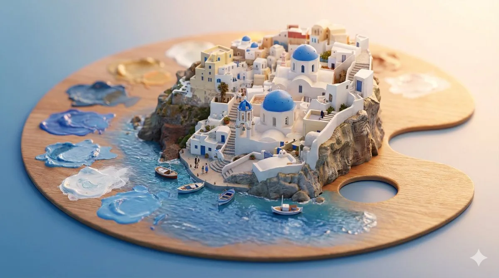

# Aleena Amir — by @aleenaamiir

[← Back to Examples from X](../../EXAMPLES.md) · Category: Illustration & 3D · Model: `Nano Banana`

<a href="https://x.com/aleenaamiir/status/2011798504482738365"></a>

Original post: **[@aleenaamiir on X](https://x.com/aleenaamiir/status/2011798504482738365)** · Creator: [Aleena Amir](https://x.com/aleenaamiir)

## Prompt

```text
Create a stylized miniature 3D diorama viewed from a 45-degree angled perspective, emphasizing careful scale, clean geometry, and fine craftsmanship.

A [OBJECT] serves as the central base of the composition. From within or above this object, a miniature interpretation of [LOCATION NAME] emerges naturally, forming a compact, self-contained world.

The scene highlights recognizable landmarks, terrain features, or symbolic structures associated with [LOCATION NAME], arranged harmoniously and rendered with precise detail.

Miniature roads, paths, or environmental elements flow through the scene, with tiny vehicles, figures, or subtle motion cues adding realism and life.

Use cinematic lighting, soft highlights, and selective depth-of-field blur to create a magical, dreamlike atmosphere.

Balance playful isometric styling with realistic materials and lighting, achieving a polished, premium diorama look.

Highly detailed, cohesive composition with an 8K cinematic finish, refined miniature-world aesthetic.
```

## Try it

Paste the prompt into **[vinano.ai](https://vinano.ai?utm_source=github&utm_medium=readme&utm_campaign=awesome-image-video-prompts-updating&utm_content=x-page-try)** to generate your own version.

> The image and prompt belong to [@aleenaamiir](https://x.com/aleenaamiir) and are shown here with credit for reference. Creators can ask for changes or removal by opening an issue.
