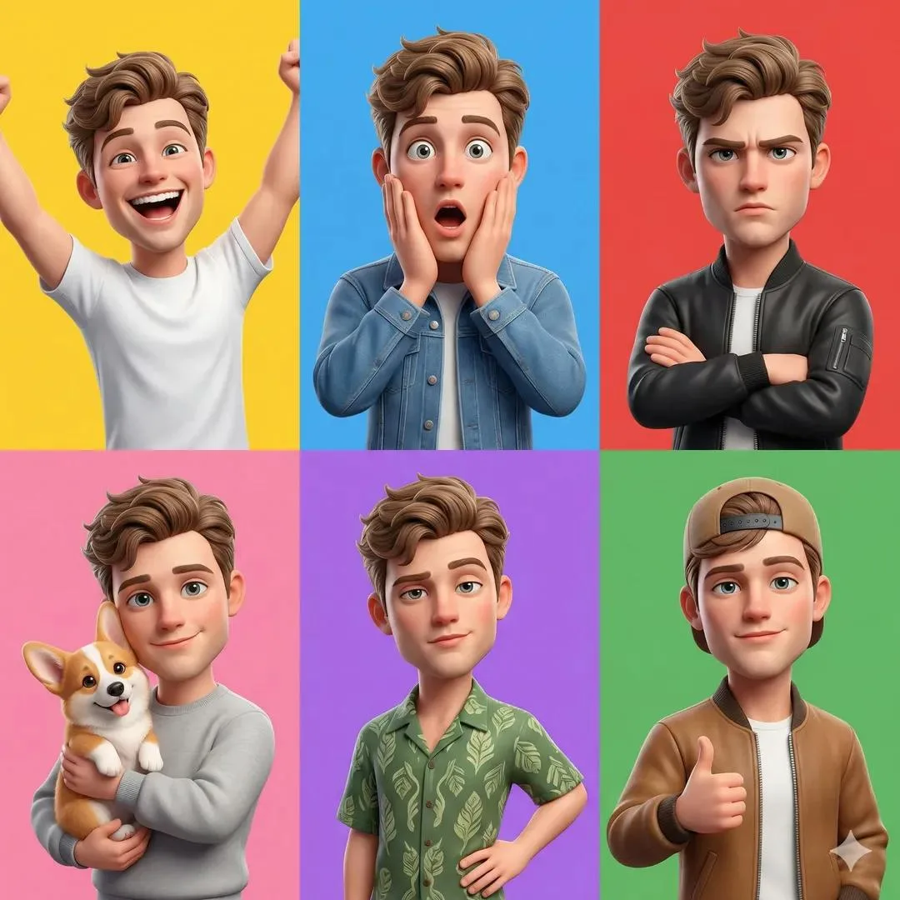

# Taaruk — by @Taaruk_

[← Back to Examples from X](../../EXAMPLES.md) · Category: Illustration & 3D · Model: `Nano Banana`

<a href="https://x.com/Taaruk_/status/2022690823062884582"></a>

Original post: **[@Taaruk_ on X](https://x.com/Taaruk_/status/2022690823062884582)** · Creator: [Taaruk](https://x.com/Taaruk_)

## Prompt

```text
A 3D Pixar-style animated young male character showcased in a 6-panel grid layout, each panel featuring a different facial expression and outfit. Bright solid color backgrounds (yellow, blue, red, pink, purple, green). The character has soft brown wavy hair, expressive large eyes, smooth skin, and stylized cartoon proportions.
```

## Try it

Paste the prompt into **[vinano.ai](https://vinano.ai?utm_source=github&utm_medium=readme&utm_campaign=awesome-image-video-prompts-updating&utm_content=x-page-try)** to generate your own version.

> The image and prompt belong to [@Taaruk_](https://x.com/Taaruk_) and are shown here with credit for reference. Creators can ask for changes or removal by opening an issue.
