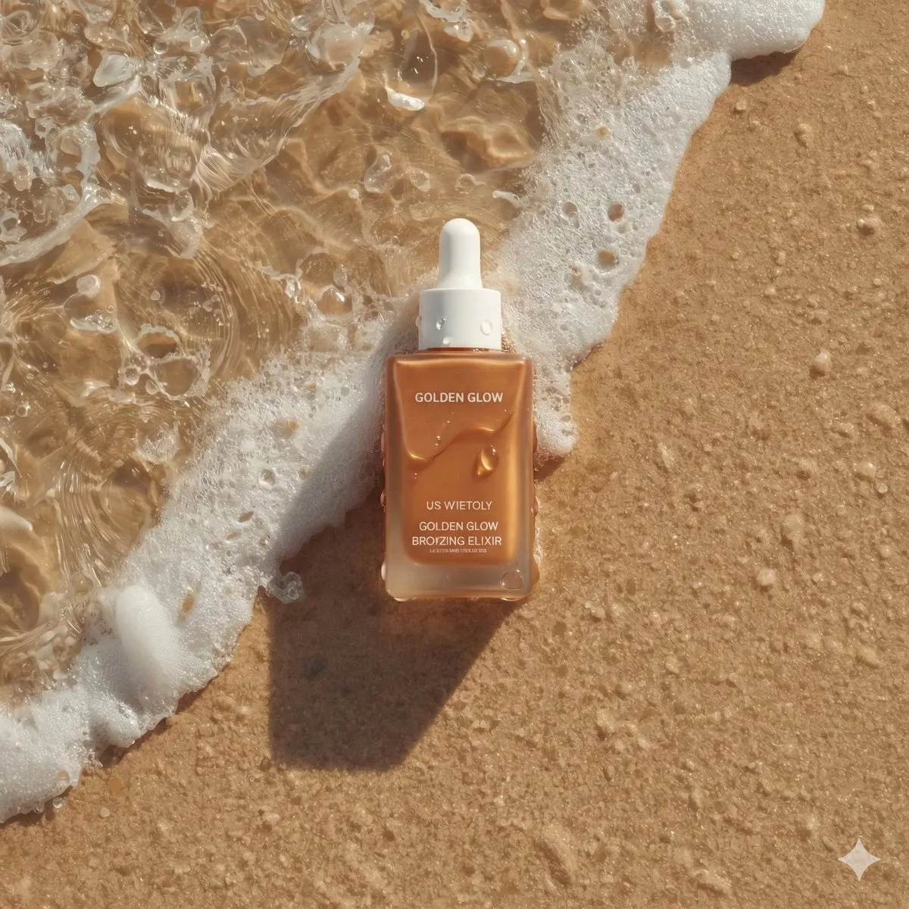

# Yaseen Khan Gul — by @YaseenK7212

[← Back to Examples from X](../../EXAMPLES.md) · Category: Product & Brand · Model: `Nano Banana`

<a href="https://x.com/YaseenK7212/status/2021835757183209806"></a>

Original post: **[@YaseenK7212 on X](https://x.com/YaseenK7212/status/2021835757183209806)** · Creator: [Yaseen Khan Gul](https://x.com/YaseenK7212)

## Prompt

```text
Ultra-realistic summer skincare product photography of a bronzing drop bottle named "Golden Glow - Bronzing Elixir", rectangular matte bottle in warm sun-kissed bronze tone with a clean white cap, placed diagonally on wet beach sand as a gentle ocean wave washes over it, delicate sea foam and tiny bubbles surrounding the base, water partially flowing across the label, fine sand texture visible beneath shallow clear water, golden sunlight casting natural highlights and soft shadows, high-detail water ripples and realistic foam patterns, fresh summer aesthetic, minimal clean branding centered and sharp, warm golden-hour beach lighting, cinematic top-down flat lay composition, natural reflections on wet surface, editorial beauty campaign style, ultra-detailed, photorealistic 8K, soft warm color grading, luxury skincare advertisement Aspect ratio 4.5
```

## Try it

Paste the prompt into **[vinano.ai](https://vinano.ai?utm_source=github&utm_medium=readme&utm_campaign=awesome-image-video-prompts-updating&utm_content=x-page-try)** to generate your own version.

> The image and prompt belong to [@YaseenK7212](https://x.com/YaseenK7212) and are shown here with credit for reference. Creators can ask for changes or removal by opening an issue.
