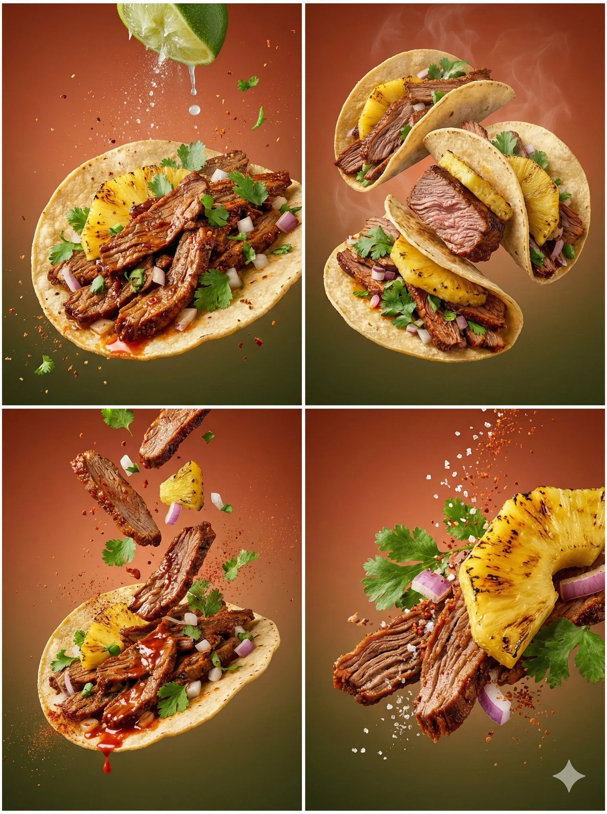

# Aleena Amir — by @aleenaamiir

[← Back to Community Examples](../../EXAMPLES.md) · Category: Food & Drink · Model: `Nano Banana`

<a href="https://x.com/aleenaamiir/status/2010241026363986218"></a>

Source: **[@aleenaamiir on X](https://x.com/aleenaamiir/status/2010241026363986218)** · Creator: [Aleena Amir](https://x.com/aleenaamiir)

## Prompt

```text
Ultra-high-quality, hyper-realistic commercial food photography of [COUNTRY FOOD NAME], rendered in 8K detail with a (4:3 or 3:4) aspect ratio.

The food is shown in multiple premium visual variations, each highlighting texture, layers, and freshness in a cinematic way.

Food details:
– Authentic [COUNTRY] cuisine presentation
– Clearly visible layers, fillings, or structure specific to [FOOD TYPE]
– Rich, natural colors and realistic textures

Motion & drama:
– Subtle mid-air elements (crumbs, ingredients, sauce, or spices)
– Natural gravity realism, frozen motion
– No mess, clean and controlled composition

Lighting & camera:
– Controlled studio lighting emphasizing texture and shine
– High-speed photography look
– Shallow to medium depth of field

Background:
– Solid or soft gradient background in [BACKGROUND COLOR]
– Clean, seamless, distraction-free

Style & finish:
– Luxury food advertising aesthetic
– Rich contrast, warm natural tones
– Ultra-sharp focus, no artificial glow

Negative prompt:
Text, logos, branding, hands, people, utensils, plates, tables, cartoon style, burnt food, overexposure, low-detail textures, artificial shine.
```

## Try it

Paste the prompt into **[vinano.ai](https://vinano.ai?utm_source=github&utm_medium=readme&utm_campaign=awesome-image-video-prompts-updating&utm_content=x-page-try)** to generate your own version.

> The image and prompt belong to @aleenaamiir ([original post](https://x.com/aleenaamiir/status/2010241026363986218)) and are shown here with credit for reference. Creators can ask for changes or removal by opening an issue.
